<p align="center">
  
</p>

<h1 align="center">OfferU</h1>

<p align="center">
  <strong>Give OfferU a job. Get an evidence-backed application workspace.</strong><br/>
  See what the role really asks for, what you can prove, and what to prepare next.
</p>

<p align="center">
  <em>A local-first AI Career OS that compounds what you learn across jobs and interviews.</em>
</p>

<p align="center">
  <strong>English</strong> ·
  <a href="#watch-the-videos">Videos</a> ·
  <a href="./README_ZH.md">简体中文</a> ·
  <a href="./docs/DEVELOPMENT.md">Quickstart</a> ·
  <a href="./docs/PRD.md">PRD</a> ·
  <a href="./docs/README.md">Docs</a>
</p>

<p align="center">
  <em>Local-first · Evidence-driven · Human-controlled</em>
</p>

<p align="center">
  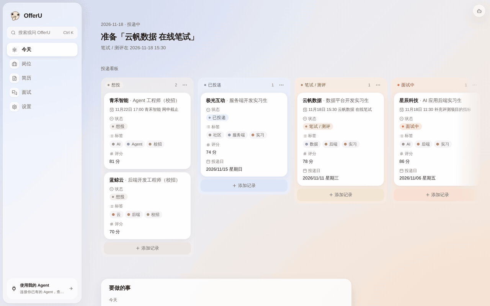
</p>

<h3 align="center" id="watch-the-videos">Watch the videos</h3>

<table>
  <tr>
    <td width="50%"><a href="./asset/video/offeru-launch-60s.mp4">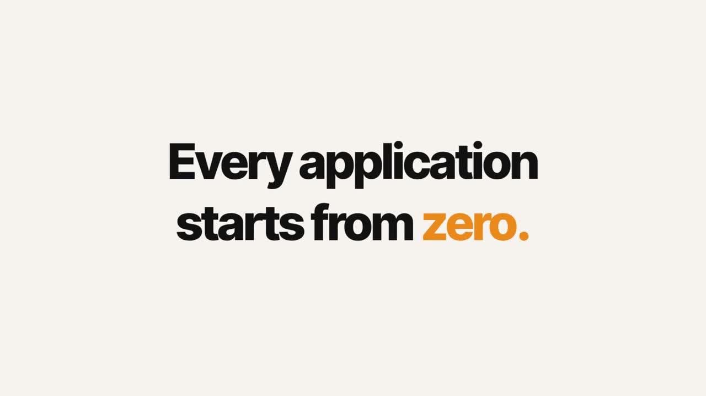</a></td>
    <td width="50%"><a href="./asset/video/offeru-walkthrough-en.mp4">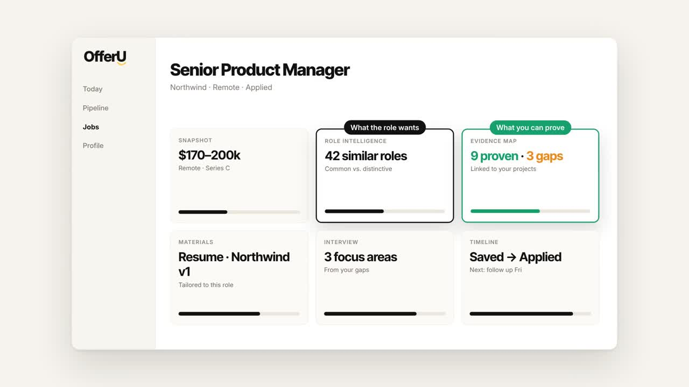</a></td>
  </tr>
  <tr>
    <td align="center"><a href="./asset/video/offeru-launch-60s.mp4"><strong>Launch film · 1 min</strong></a><br/>Why every application should start from evidence, not from zero</td>
    <td align="center"><a href="./asset/video/offeru-walkthrough-en.mp4"><strong>Product walkthrough · 2 min 40 s</strong></a><br/>Save a job → Role Intelligence → tailored resume → Pipeline</td>
  </tr>
</table>

<p align="center"><sub>Click a cover to play the 1080p video.</sub></p>

<p align="center">
  <em>Internal Beta — source available, signed installer not yet released. See <a href="./docs/KNOWN_ISSUES.md">Known issues</a>.</em>
</p>

<h3 align="center" id="screenshots">Screenshots</h3>

<p align="center">
  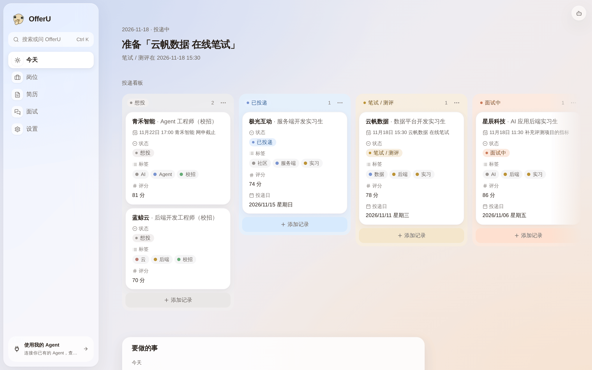<br/>
  <sub><strong>Today</strong> — the one next step that matters, with every application on a board below it.</sub>
</p>

<table>
  <tr>
    <td width="50%" valign="top">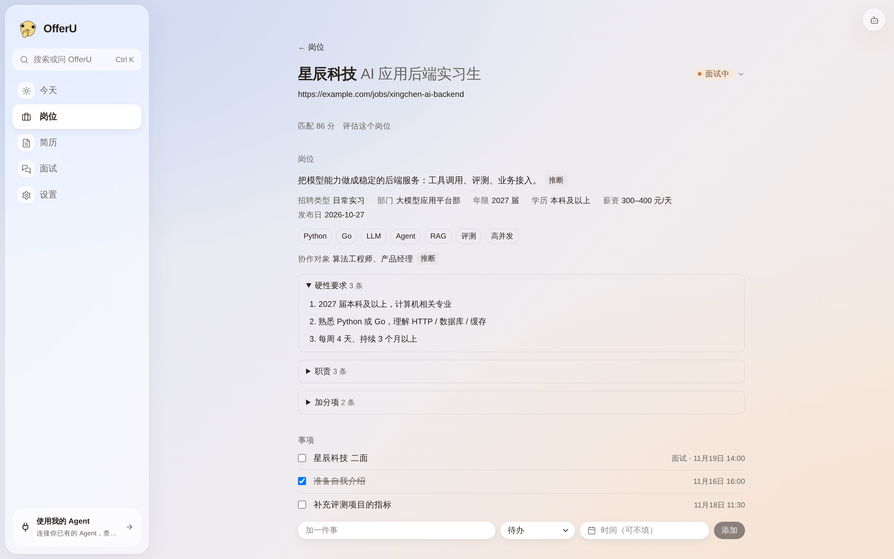<br/><strong>Job detail</strong><br/><sub>The posting broken into essence, hard requirements, keywords and collaborators, next to the job's events.</sub></td>
    <td width="50%" valign="top">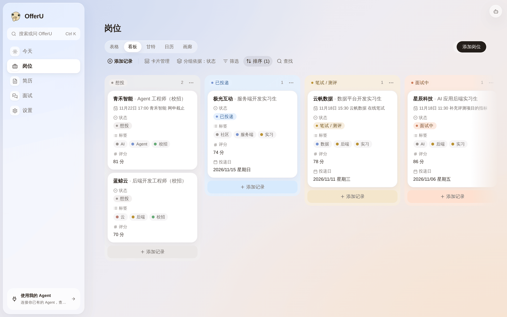<br/><strong>Pipeline board</strong><br/><sub>Every job by stage, with its next deadline, tags and match score on the card.</sub></td>
  </tr>
  <tr>
    <td width="50%" valign="top">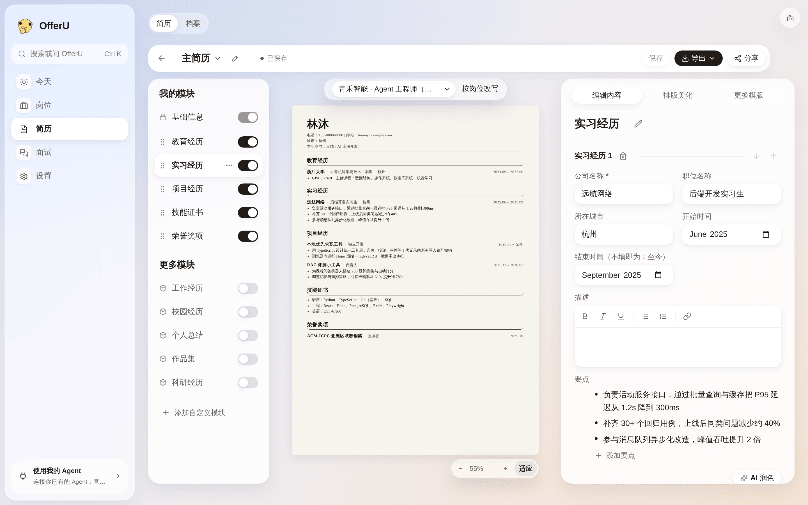<br/><strong>Résumé workspace</strong><br/><sub>Module editor and live one-page preview; pick a target job and tailor it.</sub></td>
    <td width="50%" valign="top">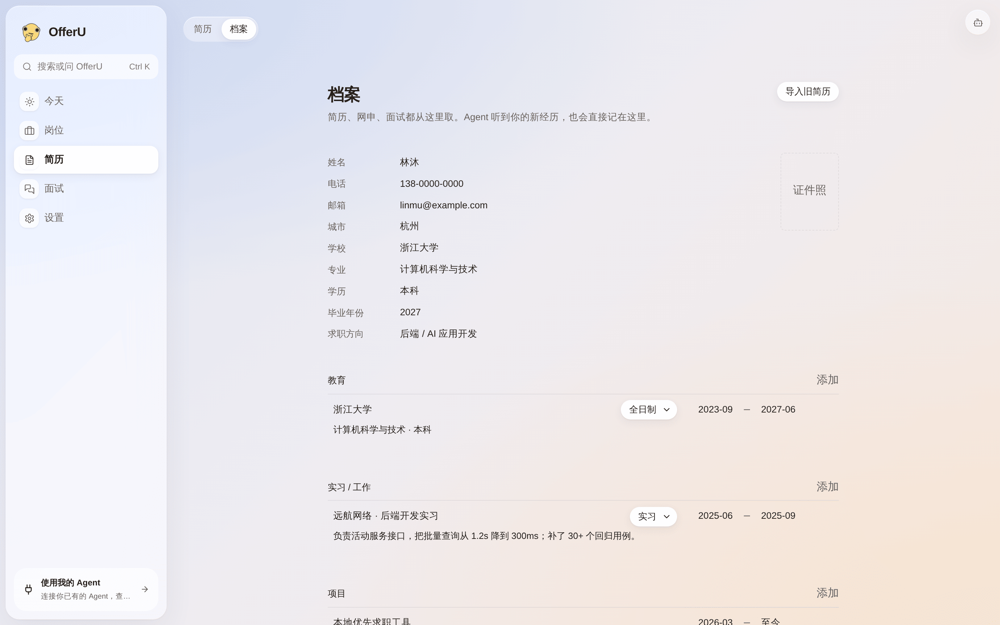<br/><strong>Career profile</strong><br/><sub>Education, internships, projects and skills: the evidence résumés and applications draw from.</sub></td>
  </tr>
  <tr>
    <td width="50%" valign="top">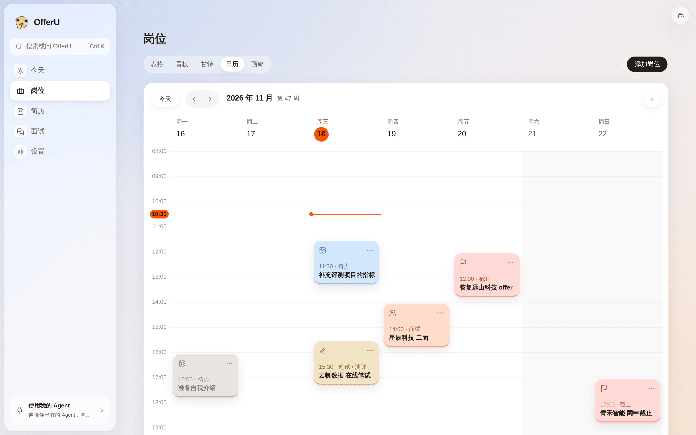<br/><strong>Calendar</strong><br/><sub>Interviews, tests and deadlines from every job on one week view.</sub></td>
    <td width="50%" valign="top">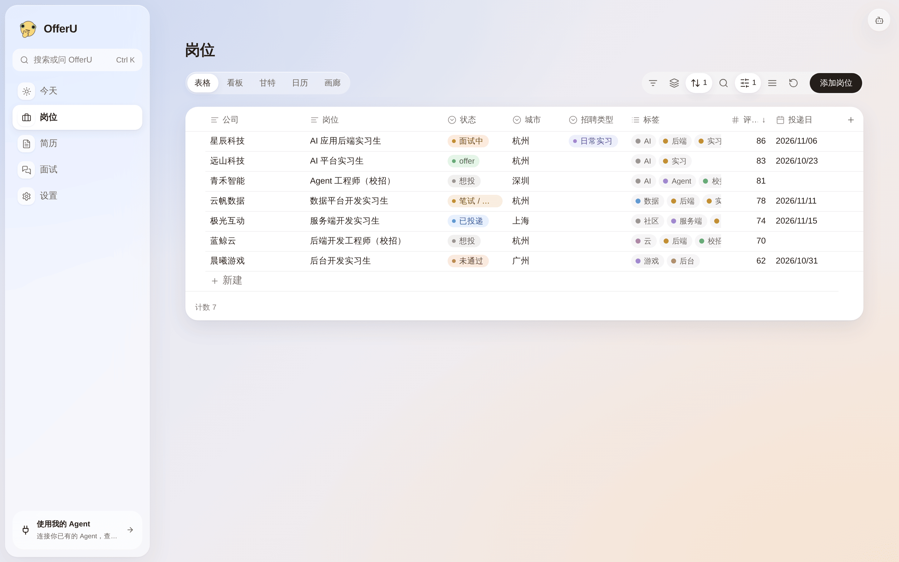<br/><strong>Jobs table</strong><br/><sub>A multi-view job table: table, board, Gantt, calendar and gallery share one dataset.</sub></td>
  </tr>
  <tr>
    <td width="50%" valign="top">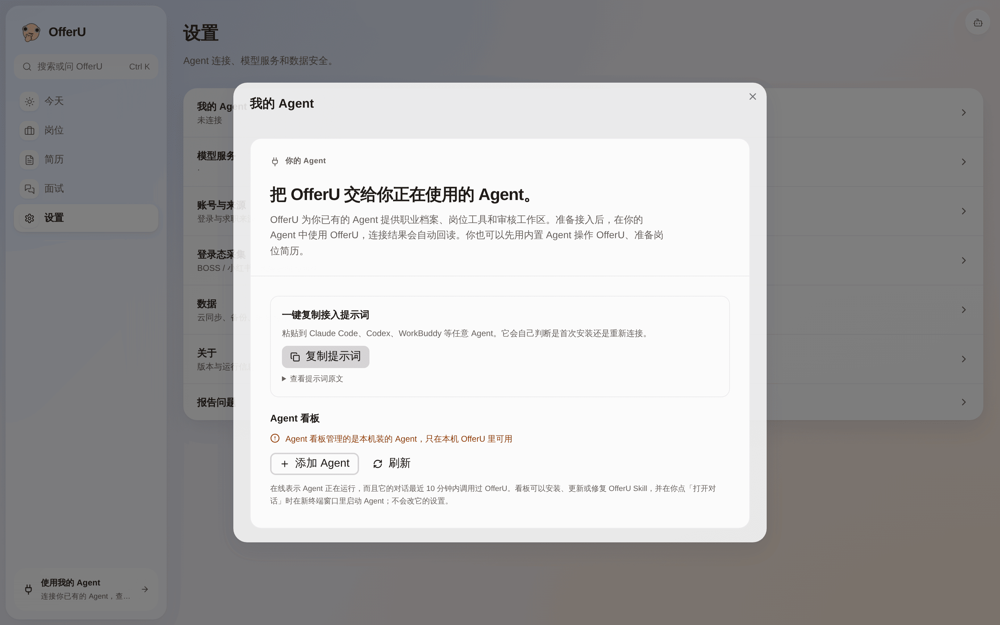<br/><strong>Bring your own Agent</strong><br/><sub>Copy one prompt into Claude Code, Codex or another agent and it works on OfferU with you.</sub></td>
    <td width="50%" valign="top">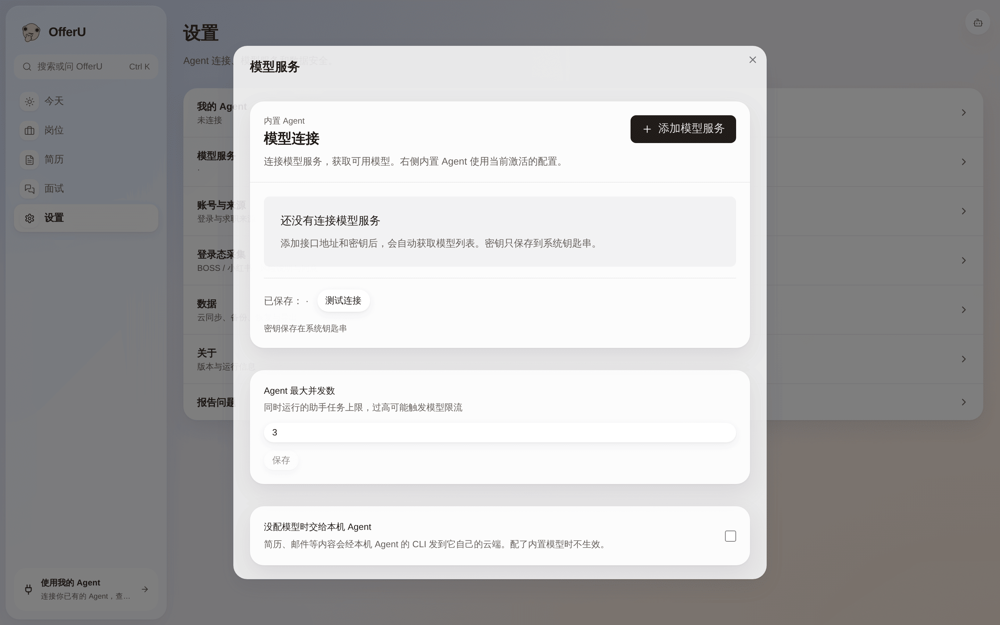<br/><strong>Model service</strong><br/><sub>Connect any OpenAI-compatible endpoint; the key is stored on your device.</sub></td>
  </tr>
</table>

<p align="center"><sub>Fictional demo workspace — companies, candidate and links are made up. Captured from the web app at 1440×900.</sub></p>

---

## Why OfferU?

Most job-search tools solve one step.

Your JD lives in the browser. Your resume lives in a file. Research lives in another tab. Application tracking becomes a spreadsheet. Interview learning disappears into another AI chat.

So every application starts from zero.

OfferU changes the unit of work from **a chat** to **a durable Job Workspace**:

```text
Target Job
    ↓
What does this role really care about?
    ×
What can I actually prove?
    ↓
What should I prepare next?
    ↓
Evidence-backed Job Workspace
```

That Workspace then compounds into the larger Career OS:

```text
Career Profile
      ↓
   Save Job
      ↓
Role Intelligence
      ↓
Evidence Gap
      ↓
Tailored Resume
      ↓
Application Pipeline
      ↓
Targeted Interview
      ↓
Debrief & Learning
      ↺
```

Instead of opening a fresh AI chat for every job, OfferU keeps one persistent, evidence-backed career
context and carries what it learns across the entire search.

### One Job, one durable Workspace

A Job is not just a detail page. It is the canonical workspace for one opportunity:

```text
Job Snapshot
Role Intelligence
Evidence Map
Application Materials
Interview
Timeline / Next Action
```

Agent work progressively materializes into these objects, so closing a chat does not make the work disappear.

### Persistent career context

OfferU maintains structured career evidence — experience, achievements, skills, preferences, goals and
reviewed learning observations.

AI suggestions never silently become career facts. New information enters a reviewable candidate flow
before it can update your long-term profile.

### Role Intelligence

OfferU does not only summarize a job description. It compares the target role against a cohort of
similar jobs, separates what is common from what is distinctive, and maps those signals against your
own evidence.

```text
What does this role emphasize?
           ×
What can I actually prove?
           ↓
What should I prepare next?
```

### Evidence-grounded resume tailoring

Every target job can have its own tailored resume without overwriting the source resume.

The Resume Workspace supports structured manual editing, live A4 / Letter preview, job-specific resume
versions, AI proposals with before / after diffs, accept / reject review, stale-proposal protection and
PDF export.

AI-generated claims are checked against career evidence before they become trusted application content.

### Application pipeline

Today, Pipeline, Job Detail and Timeline all read from the same underlying career state. Application
progress is modeled as **events** rather than independent UI state, so OfferU can project one truth
across the product instead of asking you to maintain several trackers.

Paste an application receipt or a test / interview invitation into the Agent and it moves the job forward
and records the event with its time and assessment or meeting link. On desktop you can connect a QQ / 163 / Gmail mailbox in Settings → 邮箱 with an app password (授权码): the Agent reads invitations to update the board, application emails go to your Drafts folder with the tailored resume attached, and nothing is sent until you click 确认发送 (not available in the web version).

### Targeted interview practice

Interview preparation is grounded in the intersection of role delta, career evidence gap and previous
interview learning:

```text
Role Delta
×
Career Evidence Gap
×
Previous Interview Learning
```

OfferU generates targeted focus areas, runs turn-based practice, challenges vague answers, produces
transcript-backed debriefs and turns useful observations into reviewable learning candidates.

### Your AI, with a controlled Career OS

OfferU prefers the local AI agent you already use and allows a built-in fallback, but no model owns business truth.

```text
External local Agent (preferred) / OfferU fallback
    ↓
OfferU Skill + optional Career Skills
    ↓
Agent Tool Surface
    ↓
Operation Registry
    ↓
Proposal / Approval
    ↓
Career Runtime
```

The active agent reasons. OfferU controls capabilities, evidence, side effects and persistent truth. Third-party resume/interview/recruiting Skills may contribute methodology, while sensitive changes and irreversible actions remain under OfferU and user control.

---

## Product surfaces

| Surface      | Purpose                                                                                            |
| ------------ | -------------------------------------------------------------------------------------------------- |
| **Today**    | What changed, what OfferU finished, what needs your attention, and what matters next              |
| **Pipeline** | Every opportunity, application stage, timeline and next action                                     |
| **Job**      | Durable Job Workspace: snapshot, Role Intelligence, Evidence Map, materials, interview and timeline |
| **Profile**  | Long-term career evidence, goals, preferences and reviewed learning                                |

Memory is a mechanism for evolving Profile — not a separate product silo.
The Agent is a system-wide capability — not another disconnected chat window.
The `extension/` browser add-on (WXT) is the job-capture surface — it imports listings into the
same Operation Registry instead of scraping or auto-applying on its own.

---

## AI setup

The product has **two front doors and one Career Truth**.

**Normal users: App-first**

```text
Install OfferU
→ auto-detect local AI
→ project/register OfferU Skill where supported
→ save a Job
→ work appears in the canonical Job Workspace
```

**Power users: Skill-first**

```text
Open Codex / Claude Code / WorkBuddy / OpenCode / OMP / another supported host
→ enable OfferU Skill
→ "analyze this job for me"
→ Agent creates/resolves the canonical Job
→ open the same Job Workspace in OfferU
```

The product direction remains **Connect → Auto → Ready**.

> **Skill is the Agent entry; Job Workspace is the user product.**

Normal users should not have to understand runtimes, protocol versions, model IDs or custom endpoints.
OfferU detects a local agent you already have, checks it, and consumes its own model and account:

```text
        OfferU

   AI Connection
        ↓
    Auto Detect
        ↓
┌────────────┼────────────┐
Codex  WorkBuddy  Claude  OMP / others
        ↓
   OfferU Skill
   + compatible Career Skills
        ↓
   OfferU Bridge
        ↓
 Operation Registry
        ↓
   Career Runtime
```

If you already use **Codex** with your ChatGPT account, **Claude Code** with your Claude account, or
**OpenCode**, OfferU does not need an API key from you at all — the agent brings its own model and
authentication.

API configuration is the fallback for users with no local agent, self-hosting users, and advanced users
who deliberately want to configure the stack. It lives behind Advanced, where you get two protocols
rather than dozens of vendor presets:

- OpenAI-compatible endpoint
- Anthropic-compatible endpoint

Runtime diagnostics, experimental providers and provider health are advanced / developer surfaces.

---

## Architecture

One set of rules, three places it runs:

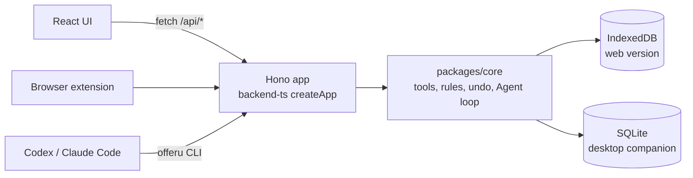

- **`packages/core`** — pure TypeScript domain rules: the tool registry, validation, overview, change log
  and undo, resume rendering, the built-in Agent loop. No React, DOM or Node APIs.
- **`backend-ts`** — one runtime-agnostic Hono app plus adapters. It runs **inside the page** for the web
  version (data in IndexedDB), as the **Node desktop companion** (SQLite, local files, PDF, BOSS login),
  and its **Cloudflare Worker** entry serves the static site and relays model calls. The Worker stores
  nothing: no D1, KV, Durable Objects or R2.
- The previous Python (FastAPI) backend has been removed; its last version is tagged
  [`python-backend-final`](https://github.com/avabbbb/OfferU/tree/python-backend-final). Where each of its routes went:
  [docs/route-coverage.md](./docs/route-coverage.md).

Capabilities per runtime, where code lives and how to add a tool: [docs/ARCHITECTURE.md](./docs/ARCHITECTURE.md).
Data model and tool semantics: [docs/DESIGN.md](./docs/DESIGN.md).

---

## Current technology

```text
React / TypeScript   → product UI (Vite)
TypeScript + Hono    → backend: packages/core rules, backend-ts adapters
IndexedDB            → web version data (in the user's browser)
SQLite (node:sqlite) → desktop companion data
Cloudflare Workers   → static hosting + stateless model relay (free plan)
Tauri / Rust         → desktop shell
```

OfferU intentionally does not duplicate business logic across UI, CLI, plugins and agent integrations.

---

## Safety principles

- AI output is not automatically career truth.
- Important mutations are reviewable and auditable.
- External irreversible actions require explicit user control.
- Browser automation may assist with forms but must not silently submit applications.
- Career evidence preserves provenance; behaviour signals and model inferences enter a review inbox first.
- Provider failures must be visible rather than silently returning fake success.
- Your data stays with you: in your browser (web version) or on your machine (desktop). The Cloudflare
  Worker only serves static files and relays model calls; it keeps no user data and no logs of them.
- In the web version API keys are encrypted with a non-extractable per-browser key before they are
  stored in IndexedDB. The desktop companion keeps them in its local data directory (file mode 0600).
- Credentials should stay out of model context, logs and version control.

See [SECURITY.md](./SECURITY.md) for the current security status.

---

## Getting started

OfferU is not yet published as a signed consumer installer.

**Web version (data stays in your browser)**

```bash
npm --prefix backend-ts install && npm --prefix frontend install
cd backend-ts
npm run build:web        # frontend in local-web mode
npx wrangler deploy      # free Cloudflare Workers plan; or `npm run worker:dev` locally
```

Open the site, add your model API key under Settings → Model, and start. See
[docs/DEPLOY-CLOUDFLARE.md](./docs/DEPLOY-CLOUDFLARE.md).

**Local workbench + external Agent (Node companion, data in SQLite on this machine)**

```bash
npm --prefix backend-ts install && npm --prefix frontend install
npm --prefix frontend run build
npm --prefix backend-ts run cli -- start     # workbench + API on http://127.0.0.1:8766
npm --prefix backend-ts run --silent cli -- tool          # what external Agents call: one line per tool; `tool <name> --help` for its schema
```

Node 22.19+. The old Python package (`v0.2.0-lite`) is retired. The Agent Skill is
[`.agents/skills/offeru/SKILL.md`](./.agents/skills/offeru/SKILL.md); Settings → My Agent → Connect installs it with this machine's `offeru` command filled in. There is no MCP server: Agents call the CLI.

**Source development** — [docs/DEVELOPMENT.md](./docs/DEVELOPMENT.md) (npm commands, tests, contract tests).

---

## Release status

- Python → TypeScript route coverage: [docs/route-coverage.md](./docs/route-coverage.md)
- Known gaps: [docs/KNOWN_ISSUES.md](./docs/KNOWN_ISSUES.md)

```bash
cd backend-ts && npm test && npm run typecheck
cd frontend && npm test && npm run typecheck && npm run build:web
```

These commands only validate their own scope; they do not mean "ready to release".

---

## Roadmap

Current priorities are productization, not more top-level features:

1. **Zero-Setup onboarding** — native install, local-Agent auto-discovery, Profile bootstrap, first Job, useful Today.
2. **Real external-Agent Eval** — validate autonomous tool discovery and complete user journeys before further tool compression.
3. **Browser + inbox productization** — one-click job capture; desktop can now read invitations, save drafts and send after your confirmation over IMAP / SMTP; real-mailbox acceptance and Outlook OAuth are still open.
4. **Public desktop release** — signed installer, clean-machine setup, migration, backup, restore and upgrade.
5. **Privacy, security and real-user iteration** — keep trust gates hard while reducing user effort.

---

## Contributing

Contributions are welcome! Please feel free to submit a Pull Request.

- [PRD](./docs/PRD.md) — users, scope and acceptance
- [System design](./docs/DESIGN.md) — data, tools, agents and undo
- [Architecture](./docs/ARCHITECTURE.md) — core, adapters, runtimes
- [DEVELOPMENT.md](./docs/DEVELOPMENT.md) — development setup

1. Fork the repository
2. Create your feature branch (`git checkout -b feature/amazing-feature`)
3. Commit your changes (`git commit -m 'Add some amazing feature'`)
4. Push to the branch (`git push origin feature/amazing-feature`)
5. Open a Pull Request

See [CONTRIBUTING.md](./docs/CONTRIBUTING.md) for what the main repository accepts, including the rule on third-party integrations.

---

## License

[MIT](./LICENSE)
