<p align="center">
  
</p>

<h1 align="center">OfferU</h1>

<p align="center">
  <strong>给 OfferU 一个岗位，得到一套有证据支撑的申请工作区。</strong><br/>
  看清岗位真正要什么、你实际能证明什么，以及下一步该准备什么。
</p>

<p align="center">
  <em>一个会把每次岗位准备和面试学习持续积累起来的本地 AI Career OS。</em>
</p>

<p align="center">
  <a href="./README.md">English</a> ·
  <strong>简体中文</strong> ·
  <a href="#宣传视频">宣传视频</a> ·
  <a href="./docs/DEVELOPMENT.md">快速开始</a> ·
  <a href="./docs/PRD.md">产品需求</a> ·
  <a href="./docs/README.md">文档</a>
</p>

<p align="center">
  <em>本地优先 · 证据驱动 · 人类可控</em>
</p>

<p align="center">
  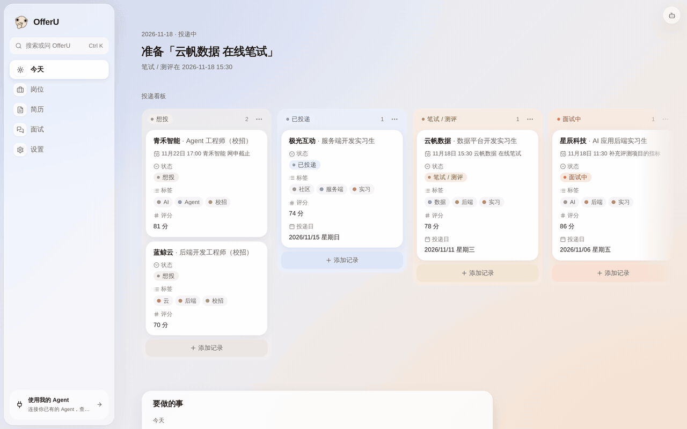
</p>

<h3 align="center" id="宣传视频">宣传视频</h3>

<table>
  <tr>
    <td width="50%"><a href="./asset/video/offeru-launch-60s.mp4">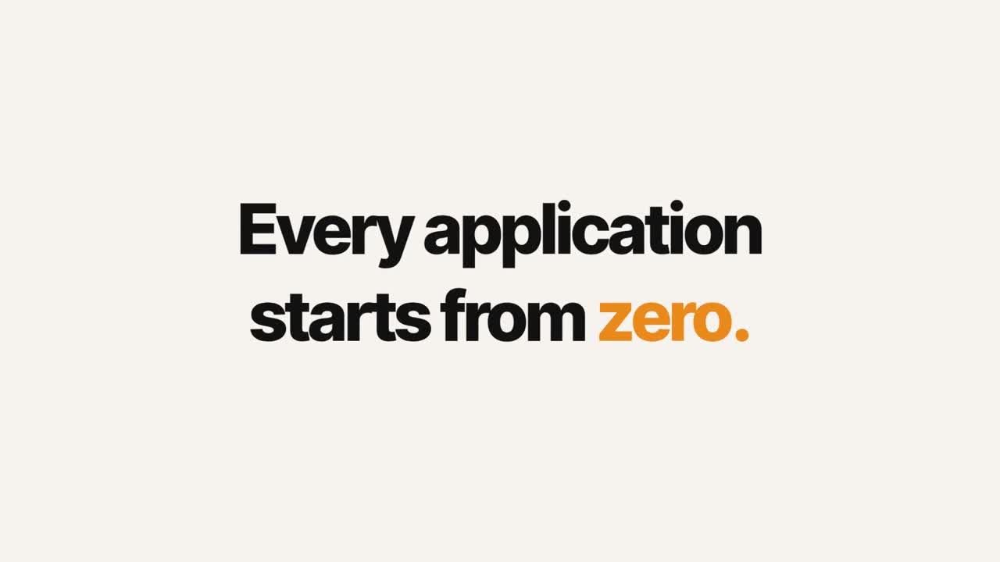</a></td>
    <td width="50%"><a href="./asset/video/offeru-walkthrough-en.mp4">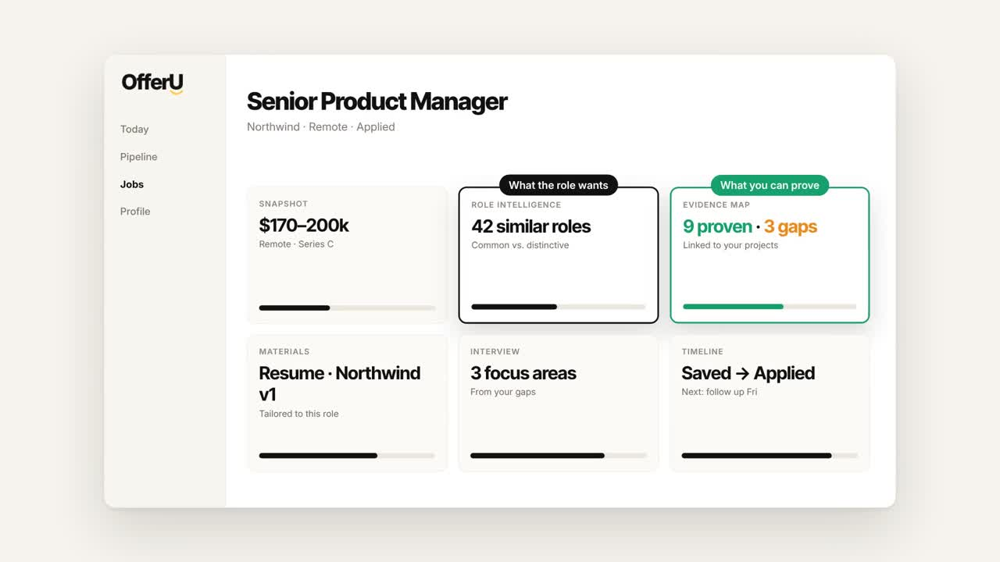</a></td>
  </tr>
  <tr>
    <td align="center"><a href="./asset/video/offeru-launch-60s.mp4"><strong>宣传片 · 1 分钟</strong></a><br/>每一次投递，都从证据出发，而不是从零开始</td>
    <td align="center"><a href="./asset/video/offeru-walkthrough-en.mp4"><strong>产品演示 · 2 分 40 秒（英文）</strong></a><br/>保存岗位 → 岗位情报 → 定制简历 → Pipeline</td>
  </tr>
</table>

<p align="center"><sub>点击封面播放 1080p 视频。</sub></p>

<p align="center">
  <em>Internal Beta —— 源码可用，签名安装包尚未发布。详见 <a href="./docs/KNOWN_ISSUES.md">已知问题</a>。</em>
</p>

<h3 align="center" id="screenshots">界面一览</h3>

<p align="center">
  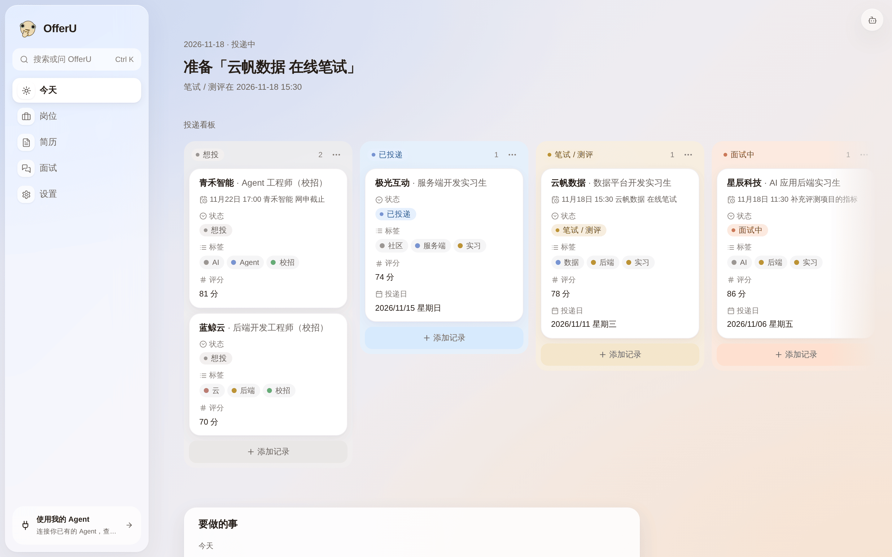<br/>
  <sub><strong>今天</strong>：最该做的一件事放在最上面，下面是所有投递的看板。</sub>
</p>

<table>
  <tr>
    <td width="50%" valign="top">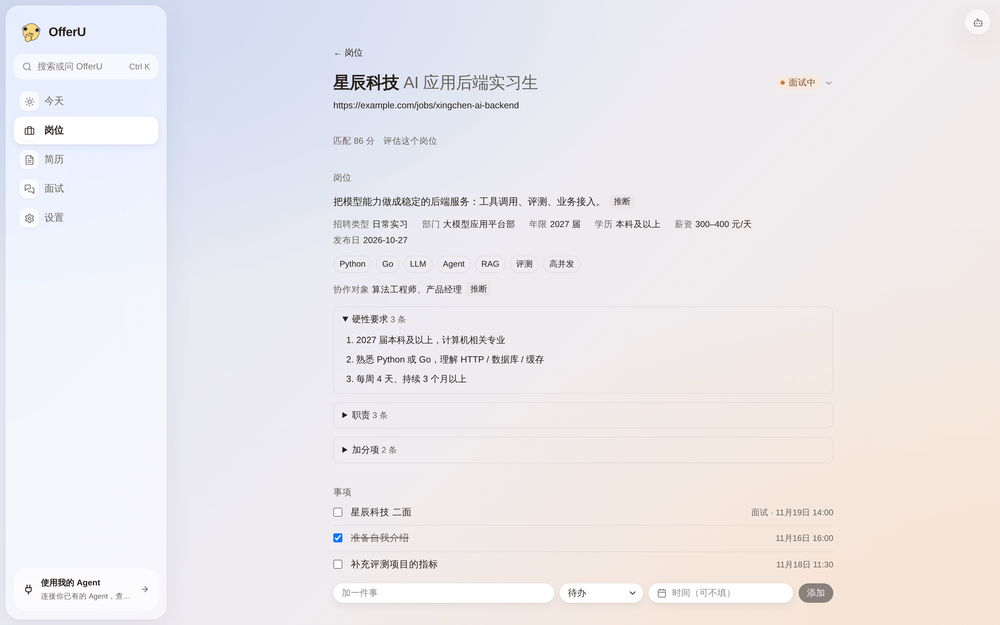<br/><strong>岗位详情</strong><br/><sub>JD 拆成本质、硬性要求、关键词和协作对象，旁边是这个岗位的事项。</sub></td>
    <td width="50%" valign="top">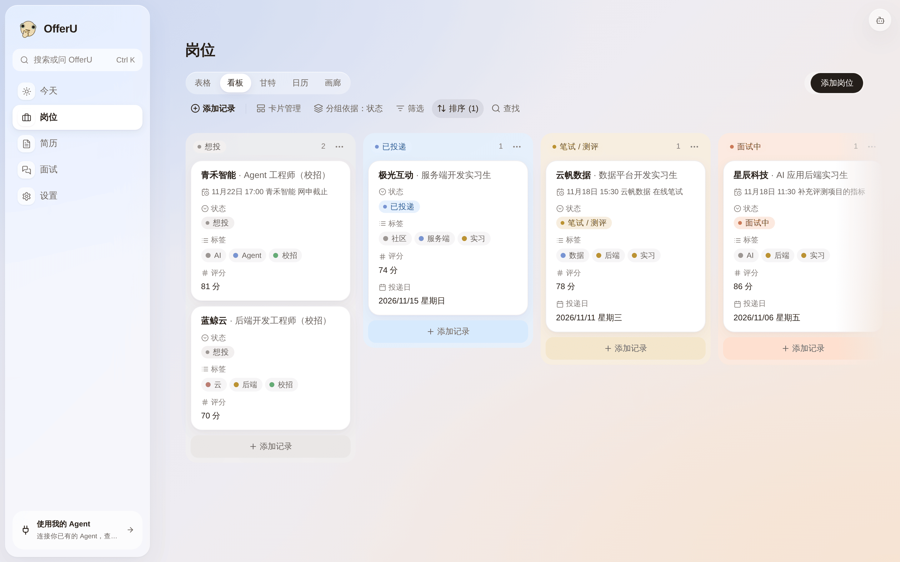<br/><strong>投递看板</strong><br/><sub>按阶段排好每个岗位，卡片上有下一个截止、标签和匹配分。</sub></td>
  </tr>
  <tr>
    <td width="50%" valign="top">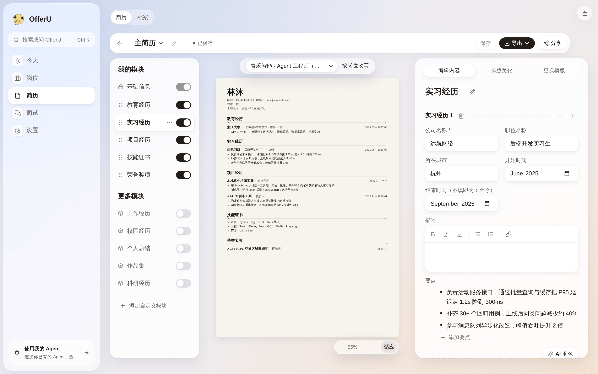<br/><strong>简历工作区</strong><br/><sub>模块化编辑 + 一页实时预览；选一个目标岗位就能按岗位改写。</sub></td>
    <td width="50%" valign="top">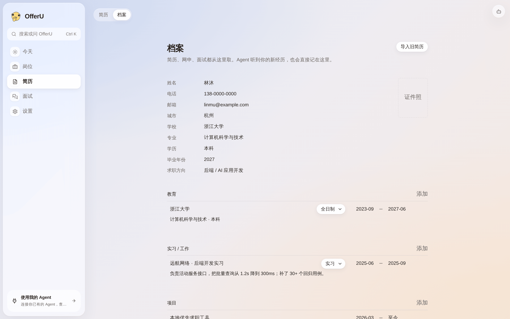<br/><strong>职业档案</strong><br/><sub>教育、实习、项目和技能：简历和网申都从这里取证据。</sub></td>
  </tr>
  <tr>
    <td width="50%" valign="top">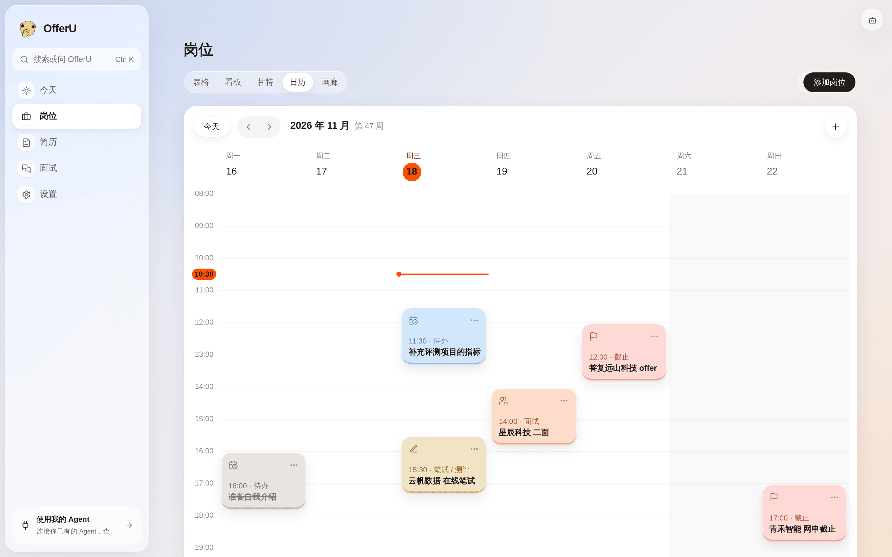<br/><strong>日历</strong><br/><sub>所有岗位的面试、笔试和截止放在一周视图里。</sub></td>
    <td width="50%" valign="top">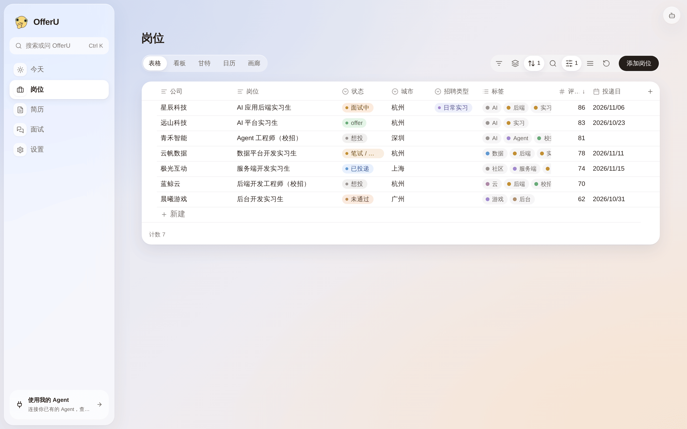<br/><strong>岗位多维表</strong><br/><sub>表格、看板、甘特、日历、画廊共用一份岗位数据。</sub></td>
  </tr>
  <tr>
    <td width="50%" valign="top">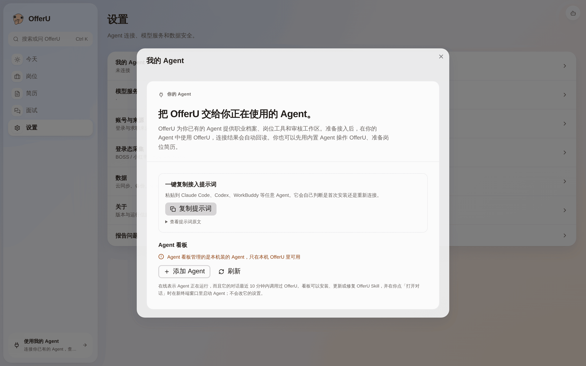<br/><strong>使用我的 Agent</strong><br/><sub>把一段提示词贴进 Claude Code、Codex 等 Agent，它就能和你一起用 OfferU。</sub></td>
    <td width="50%" valign="top">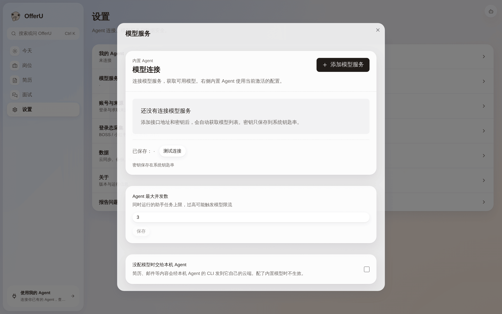<br/><strong>模型服务</strong><br/><sub>接入任意 OpenAI 兼容接口；密钥保存在本机。</sub></td>
  </tr>
</table>

<p align="center"><sub>截图使用虚构的演示数据：公司、候选人和链接均为编造。截自网页版，1440×900。</sub></p>

---

## 为什么是 OfferU

多数求职工具只解决其中一步：JD 在浏览器，简历在文件里，岗位研究在另一个页面，投递记录变成 Excel，面试复盘又散落在另一个 AI 对话里。

结果是：每投一个岗位，你都像从零开始。

OfferU 把工作的基本单位从“一次聊天”变成一个**持久的 Job Workspace（岗位工作区）**：

```text
目标岗位
   ↓
这个岗位真正看重什么？
   ×
我实际上能证明什么？
   ↓
我下一步该准备什么？
   ↓
有证据支撑的 Job Workspace
```

然后这套工作区再持续积累成更大的 Career OS：

```text
职业档案
   ↓
保存岗位
   ↓
岗位理解（Role Intelligence）
   ↓
证据缺口
   ↓
定制简历
   ↓
投递 Pipeline
   ↓
针对性面试
   ↓
复盘与学习
   ↺
```

你不需要为每一个岗位都新开一个 AI 对话。OfferU 保留一份持续积累、有证据支撑的职业上下文，
并把它学到的东西带到后续每一次申请里。

### 一个岗位，一个持久工作区

Job 不只是详情页，而是一个机会的 canonical 工作区：

```text
岗位快照
岗位理解
证据地图
申请材料
面试
时间线 / 下一动作
```

Agent 的工作会逐步物化到这些对象里，所以关掉 Agent 对话，已经完成的工作也不会消失。

### 持续积累的职业上下文

OfferU 维护结构化的职业证据：经历、成果、技能、偏好、目标和已审核的学习观察。

AI 的建议不会悄悄变成职业事实。新信息必须先进入可审核的候选流，才能更新你的长期档案。

### 岗位理解（Role Intelligence）

OfferU 不只是总结 JD。它把目标岗位和一批相似岗位做对比，区分"这个岗位普遍要求什么"和
"这个岗位特别看重什么"，再把这些信号映射回你自己的证据。

```text
这个岗位看重什么？
      ×
我实际上能证明什么？
      ↓
我下一步该准备什么？
```

### 有证据支撑的简历定制

每个目标岗位都可以有自己的定制简历，且不会覆盖原始简历。

Resume Workspace 支持结构化手工编辑、A4 / Letter 实时预览、按岗位分版本、带前后对比的
AI 提案、接受/拒绝审核、过期提案保护和 PDF 导出。

AI 生成的说法在成为可信的申请材料之前，会先和职业证据做核对。

### 投递 Pipeline

Today、Pipeline、Job Detail 和 Timeline 读的是同一份底层职业状态。投递进展被建模成**事件**
而不是各自独立的 UI 状态，所以 OfferU 能在整个产品里投射同一个事实，不需要你同时维护好几张表。

### 针对性面试训练

面试准备建立在"岗位差异 × 证据缺口 × 历史面试学习"的交集上：

```text
岗位差异
×
职业证据缺口
×
既往面试学习
```

OfferU 会生成针对性的面试重点，进行多轮对话训练，追问含糊的回答，产出基于转写的复盘，
并把有价值的观察变成可审核的学习候选。

### 用你已有的 AI，但让 Career OS 管住事实与执行

OfferU 优先复用你本机已经在用的 Agent，也允许 OfferU 内置能力作为兜底；无论使用哪个模型，都不能直接拥有业务事实或绕过确认。

```text
本地 Agent（优先）/ OfferU fallback
    ↓
OfferU Skill + 可组合求职 Skills
    ↓
Agent Tool Surface
    ↓
Operation Registry
    ↓
提案 / 审批
    ↓
Career Runtime
```

Agent 负责推理；第三方简历、招聘、面试 Skill 可以提供方法论；OfferU 负责真实职业上下文、能力边界、副作用和持久化事实。

---

## 产品入口

| 入口          | 作用                                                     |
| ------------- | -------------------------------------------------------- |
| **Today**     | 发生了什么变化、OfferU 完成了什么、需要你关注什么、下一步做什么 |
| **Pipeline**  | 所有机会、投递阶段、时间线和下一动作                     |
| **Job**       | 持久 Job Workspace：岗位快照、岗位理解、证据地图、申请材料、面试与时间线 |
| **Profile**   | 长期职业证据、目标、偏好和已审核的学习内容               |

Memory 是 Profile 的演进机制，不是独立的产品孤岛。
Agent 是全局能力，不是又一个割裂的聊天窗口。

---

## AI 连接

OfferU 有**两个入口，但只有一份 Career Truth**。

**普通用户：App-first**

```text
安装 OfferU
→ 自动发现本机 Agent
→ 支持时自动投影/注册 OfferU Skill
→ 保存一个岗位
→ 工作结果进入 canonical Job Workspace
```

**高级用户：Skill-first**

```text
打开 Codex / Claude Code / WorkBuddy / OpenCode / OMP / 其他支持宿主
→ 启用 OfferU Skill
→ “帮我分析这个岗位”
→ Agent 创建/解析 canonical Job
→ 回到 OfferU 看到同一个 Job Workspace
```

产品方向仍然是 **连接 → 自动 → 就绪**。

> **Skill 是 Agent 的入口，Job Workspace 才是用户的产品。**

普通用户不需要理解 Runtime、协议版本、模型 ID 或自定义端点。OfferU 会检测你本机已有的 Agent、
完成检查，然后直接使用它自己的模型和账号：

```text
        OfferU

   AI 连接层
      ↓
    自动检测
      ↓
┌──────────┼──────────┐
Codex  WorkBuddy  Claude  OMP / 其他
      ↓
  OfferU Skill
  + 可组合 Career Skills
      ↓
  OfferU Bridge
      ↓
 Operation Registry
      ↓
   Career Runtime
```

如果你已经在用登录了 ChatGPT 账号的 **Codex**、登录了 Claude 账号的 **Claude Code**，或者
**OpenCode**，OfferU 根本不需要你填 API Key —— Agent 自带模型和认证。

API 配置属于"没有本地 Agent / 自托管 / 高级用户"的兜底路径，收在高级设置里，并且只提供两种
协议而不是几十个厂商预设：

- OpenAI 兼容端点
- Anthropic 兼容端点

Runtime 诊断、实验性 Provider 和 Provider Health 都属于高级/开发者界面。

---

## 架构

一套规则，三个运行的地方：

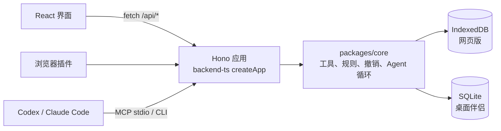

- **`packages/core`** —— 纯 TypeScript 的领域规则：工具表、校验、overview、改动记录与撤销、简历渲染、内置 Agent 循环。不依赖 React、DOM、Node。
- **`backend-ts`** —— 一个运行时无关的 Hono 应用加各运行形态的适配器：网页版里它**跑在页面内**（数据在 IndexedDB）；桌面版是 **Node 伴侣**（SQLite、本机文件、PDF、BOSS 登录）；**Cloudflare Worker** 入口只发静态网站、转发模型请求，不存任何东西（不用 D1 / KV / Durable Objects / R2）。
- 原来的 Python（FastAPI）后端已删除，最后一版在 tag [`python-backend-final`](https://github.com/avabbbb/OfferU/tree/python-backend-final)；每条路由的去向见 [docs/route-coverage.md](./docs/route-coverage.md)。

各运行形态能做什么、代码在哪、怎么加工具：[docs/ARCHITECTURE.md](./docs/ARCHITECTURE.md)。数据模型与工具语义：[系统设计](./docs/DESIGN.md)。

---

## 当前技术栈

```text
React / TypeScript   → 产品界面（Vite）
TypeScript + Hono    → 后端：packages/core 规则 + backend-ts 适配器
IndexedDB            → 网页版数据（在用户自己的浏览器里）
SQLite (node:sqlite) → 桌面伴侣数据
Cloudflare Workers   → 静态托管 + 无状态模型转发（免费计划）
Tauri / Rust         → 桌面外壳
```

OfferU 刻意不在 UI、CLI、插件和 Agent 集成之间复制业务逻辑。

---

## 安全原则

- AI 输出不会自动成为职业事实。
- 重要变更可审核、可追溯。
- 对外部的不可逆动作必须显式由你控制。
- 浏览器自动化可以辅助填表，但绝不能静默提交申请。
- 职业证据保留来源；行为信号与模型推断先进入审核收件箱。
- Provider 失败必须可见，不允许用"假成功"掩盖。
- 数据留在你手里：网页版在你的浏览器里，桌面版在你的电脑上。Cloudflare Worker 只发静态文件、转发模型请求，不保存用户数据，也不记录这些请求。
- 网页版的 API Key 用浏览器内不可导出的密钥加密后再存进 IndexedDB；桌面伴侣把 Key 存在本机数据目录（文件权限 0600）。
- 凭据不进入模型上下文、日志和版本库。

当前安全状态见 [SECURITY.md](./SECURITY.md)。

---

## 开始使用

OfferU 还没有对外发布签名安装包。

**网页版（数据只在你的浏览器里）**

```bash
npm --prefix backend-ts install && npm --prefix frontend install
cd backend-ts
npm run build:web        # 以 local-web 模式构建前端
npx wrangler deploy      # Cloudflare Workers 免费计划；本地预览用 npm run worker:dev
```

打开网站，在设置 → 模型里填自己的 API Key 即可使用。详见 [docs/DEPLOY-CLOUDFLARE.md](./docs/DEPLOY-CLOUDFLARE.md)。

**源码开发** —— [docs/DEVELOPMENT.md](./docs/DEVELOPMENT.md)（npm 命令、测试、契约测试）。

---

## 发布状态

- Python → TS 路由覆盖：[docs/route-coverage.md](./docs/route-coverage.md)
- 已知缺口：[docs/KNOWN_ISSUES.md](./docs/KNOWN_ISSUES.md)

```bash
cd backend-ts && npm test && npm run typecheck
cd frontend && npm test && npm run typecheck && npm run build:web
```

这些命令只验证各自范围，不代表"可发布"。

---

## 路线图

当前优先级是产品化，而不是继续堆顶层功能：

1. **Zero-Setup Onboarding** —— 原生安装、自动发现 Agent、建档、首个岗位、邮箱、可用 Today。
2. **真实外部 Agent Eval** —— 先证明 Agent 能自主发现并使用 OfferU Tools 跑完真实流程，再继续压缩工具面。
3. **浏览器 + 邮箱产品化** —— 一键保存岗位、只读进度同步、低门槛审核。
4. **公开桌面版发布** —— 签名安装包、clean-machine 安装、迁移、备份、恢复与升级验证。
5. **隐私、安全和真实用户迭代** —— 保持硬安全门，同时持续减少用户操作成本。

---

## 参与贡献

OfferU 正在快速走向公开的本地优先版本。贡献前请先读：

- [产品需求](./docs/PRD.md) —— 用户、范围和验收
- [系统设计](./docs/DESIGN.md) —— 数据、工具、Agent 和撤销
- [架构](./docs/ARCHITECTURE.md) —— core / 适配器 / 运行形态
- [DEVELOPMENT.md](./docs/DEVELOPMENT.md) —— 开发设置

业务规则只写在 `packages/core`，所有写入走工具表；不要引入第二个职业事实来源。

---

## License

[MIT](./LICENSE)
