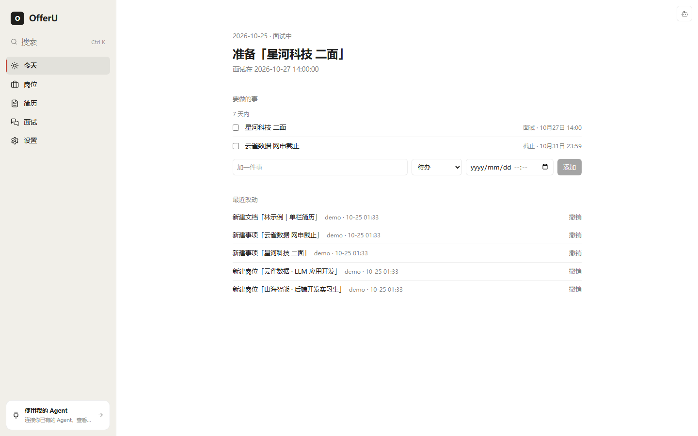
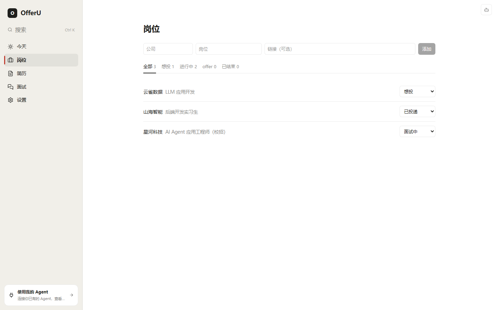
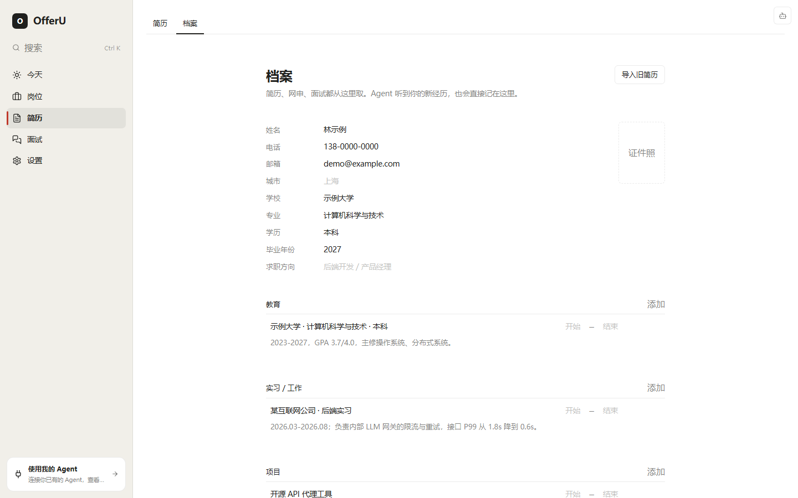
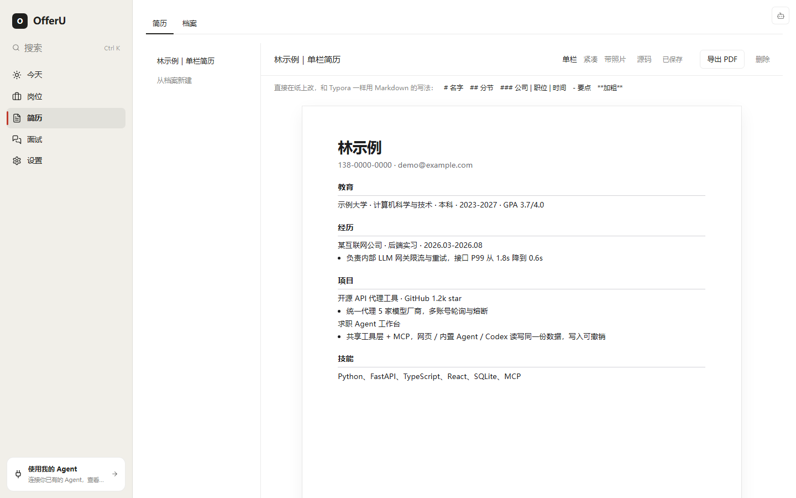
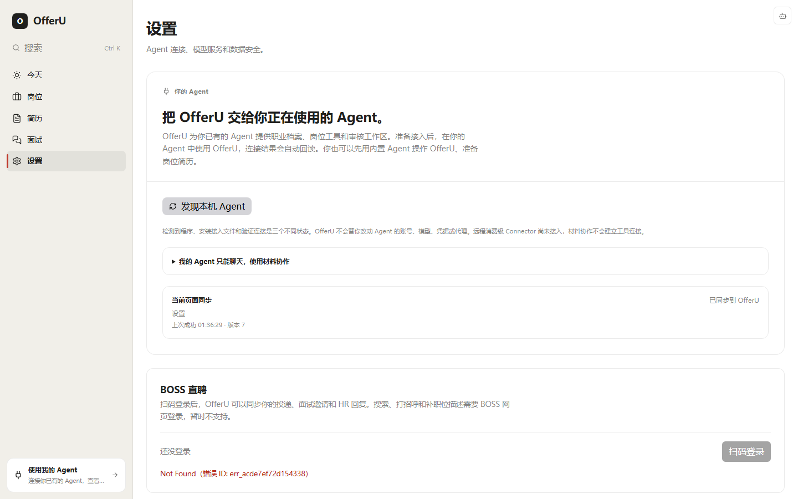
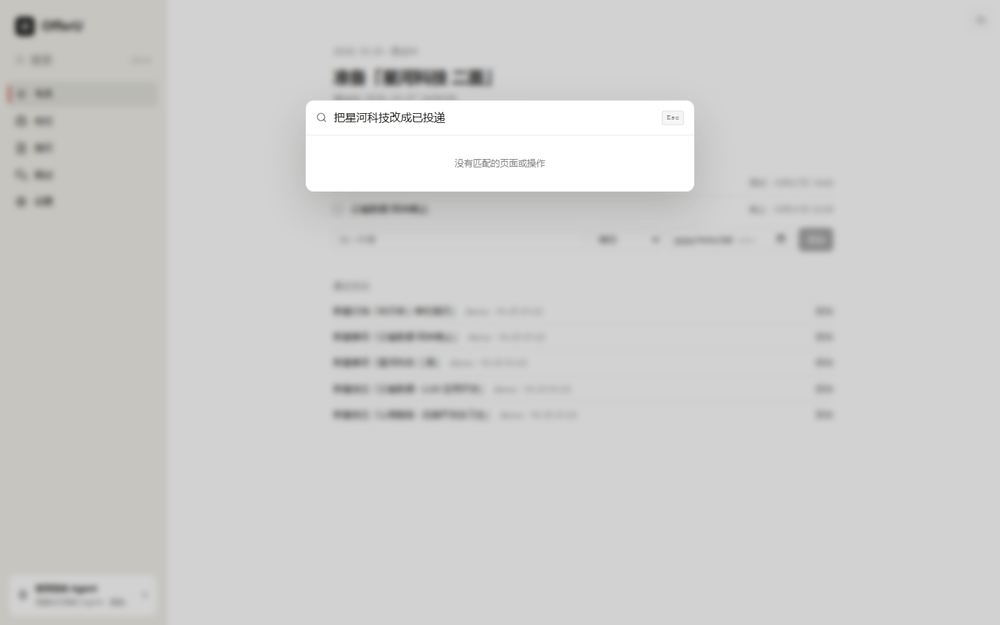

# OfferU 使用指引：网页、内置 Agent、外部 Agent

> 所有截图和录屏都用虚构演示数据（林示例 / 示例大学 / demo@example.com），由 `scripts/seed_demo.py` 生成。测试用的真实简历只在本机，没有进仓库。测试版本：`feat/core` @ `b9464a5`。

OfferU 有三种用法，底下是同一套工具和同一份数据：

| 用法 | 适合 | 当前状态 |
|---|---|---|
| 网页 | 看今天要做什么、改简历、撤销 | 可用 |
| 内置 Agent | 小任务（改个状态、记一条） | 需要可用的模型 key；Ctrl+K 还没接上 Agent |
| 外部 Agent（Codex / Claude Code） | 大任务（整份简历建档、重写） | Codex 可用（需打开工具批准） |


高清版：[walkthrough.mp4](media/walkthrough.mp4)

## 1. 启动

```bash
cd backend
pip install -r requirements.txt
python -m app.entry start
```

启动后会打印一个配对链接（5 分钟内、只能打开一次），之后直接访问 127.0.0.1:8766。

## 2. 网页

今天：最上面是「下一步」，下面是 7 天内的事和「最近改动」。不管是你、内置 Agent 还是 Codex 写的，都在这里，都能点「撤销」。



岗位：按状态（想投 / 已投递 / 面试中…）看。



档案：基本信息 + 一条条职业记忆（经历、项目、教育、技能、奖项）。简历从这里生成。



简历：Markdown 直接在纸上改，三套模板（单栏 / 紧凑 / 带照片），右上角导出 PDF。



设置：配模型 key、看外部 Agent 怎么连。



## 3. 内置 Agent

内置 Agent 用你在设置里配的模型。测试时 key 已失效，网关返回 401，但界面只说「Skill 自动路由无响应」。遇到这句话，先去设置里换 key。修复分支 fix/agent-test-findings 上已改为直接提示「模型 API key 无效或已过期」。

Ctrl+K 目前只搜页面和操作，还不能听懂「把星河科技改成已投递」这样的话（计划在 PR3）：



## 4. 外部 Agent：Codex

OfferU 提供 MCP（`python -m app.entry mcp`）和 CLI（`python -m app.entry tool <name> '<json>'`）两种入口，工具完全一样。

交互式 Codex 会弹窗问你是否允许调用工具。后台跑（`codex exec`）没人点弹窗，所以必须在配置里加 `default_tools_approval_mode = "approve"`，否则所有调用都会被静默取消。完整配置见 `.agents/skills/offeru-run/SKILL.md`。

一键跑（不改你的全局 Codex 配置）：

```bash
OFFERU_REPO=<仓库> DATA=<数据目录> bash docs/agent-testing/scripts/run_codex.sh import prompt.md
```

实测：让 Codex 读一份 1 页中文简历并建档，204 秒写入 1 条档案、15 条记忆、1 份简历。跑完后网页「最近改动」里能看到并撤销。

Claude Code 同理，走 `--mcp-config` + `--allowedTools 'mcp__offeru__*'`；先 `/login`。

## 5. Hybrid：小事内置，大事交给 Codex

设计上，内置 Agent 判断是大任务就交给后台 Codex，结果写入「最近改动」。自动交接还没做（PR5）。现在可以手动完成同样的流程：

1. 网页里做小事。
2. 大事用 `run_codex.sh` 交给 Codex。
3. 回到网页看「最近改动」，不满意就撤销。

两边写的是同一个库：Codex 通过 MCP 写入的条数，和 CLI 查出来的一致。

## 6. 常见坑

- 切分支后导 PDF 报 `No module named 'markdown_it'`：重装 requirements。
- 换了 `OFFERU_DATA_DIR` 再 start 却看到旧数据：8766 上还在跑旧实例，先停掉。修复分支上 start 会直接报错退出（exit 2）并说明原因。
- Agent 重写后简历从 1 页变 2 页：换「紧凑」模板或让 Agent 压缩。

问题清单和复盘见 [report.md](report.md)，调优过程见 [tuning-log.md](tuning-log.md)。
