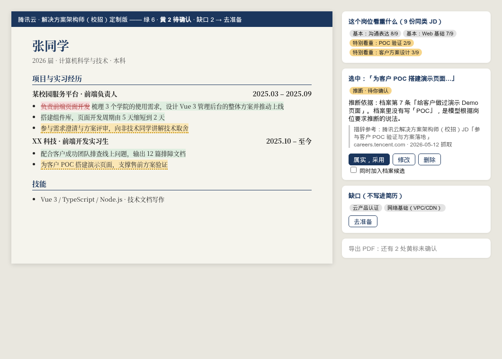

# 定制简历「重新生成」流程设计稿（待确认）

> 状态：边界已确认（硬闸门保留；推断技能可进经历条目和「技能」栏，均标黄、逐条确认）。第一刀：「纸」模板排版对齐 Kami。目标用户：国内校招 / 实习生。
> 与 [05-module-resume §3](../05-module-resume.md#3-从岗位到定制简历) 的关系：本稿**放宽「不得新增技术/职责」**为「可推断，但必须标黄、逐条确认」；**数字、公司、项目名、奖项、时间仍是硬闸门**（`resume_fact_gates.validate_generated_content` 不变）。



> 示意图里的人名、经历、JD 引用均为虚构，仅演示交互。

## 1. 要解决的问题

现在的定制只能在档案原文上删改、换顺序，写出来像「档案复读」。用户要的是：

1. 看清这个岗位**特别看重什么**，而不是把 JD 关键词全塞进去；
2. 用大厂、权威来源的**说法和描述框架**来写，而不是模型自己编词；
3. 由 LLM 重新组织每一条经历的写法。

## 2. 流程总览

```text
目标岗位 JD
  ├─① 相似岗位采样（联网，白名单优先）── 5~12 份同类 JD
  ├─② 要求拆解：基本要求（≥60% 样本都有） vs 特别看重（本岗独有/权重高）
  ├─③ 措辞参考库：大厂 careers 页 + 腾讯云/阿里云产品与解决方案文档
  ├─④ 匹配档案：每条要求 → 档案证据 / 可推断 / 缺口
  ├─⑤ LLM 重写：每条 bullet = 档案事实 + 参考框架 + 对应要求
  ├─⑥ 闸门：硬事实（数字/公司/项目/奖项/时间）必须在档案；推断技能标黄
  └─⑦ 画布逐条 diff：采用 / 修改 / 跳过；黄标必须逐条处理才能导出
```

## 3. 各步骤细节

### ① 相似岗位采样
- 来源优先级：用户已收藏岗位 → 大厂官方招聘站（腾讯/阿里/字节/美团/京东/百度/网易/小米等 careers 页，校招/实习频道）→ 通用联网搜索（必须标来源）。
- 不抓 BOSS、小红书、脉脉、牛客、猎聘、拉勾、LinkedIn（与 #88 的 `RestrictedSiteError` 列表一致）。
- 只做匿名 GET，复用 `web_search.fetch_public_html`；每次定制最多 12 个页面，结果缓存到 `job_research_runs`，7 天内复用。
- 相似度：同岗位族（前端/后端/算法/产品/售前…）+ 同届别（校招/实习/社招分开，**社招 JD 不进入校招基线**）。

### ② 要求拆解
- LLM 把每份 JD 拆成原子要求（必须是原文子串，沿用 #88 的子串校验）。
- 聚类后算覆盖率：`≥60%` 为「基本要求」（灰），本岗出现、样本里 `<30%` 为「特别看重」（琥珀），其余为「常见加分」。
- 样本 `<5` 份时不出覆盖率，只显示「样本不足，仅供参考」。

### ③ 措辞参考库
- 只提取**动词、能力框架、业务术语**（如「客户技术方案设计」「POC 验证」「架构评审」），不提取任何人的具体成果。
- 每个参考片段存 `{url, 站点, 抓取时间, 原文片段}`；画布上悬停可见出处。
- 例：前端技术支撑类经历 → 参考腾讯云/阿里云售前解决方案架构师 JD 与解决方案文档里的「需求澄清 → 方案设计 → POC → 交付支持」框架。

### ④ 匹配档案
每条要求得到三种状态之一：

| 状态 | 条件 | 颜色 |
| --- | --- | --- |
| 有证据 | 能指向 `verified_fact` 条目 | 绿 |
| 可推断 | 档案里有相关经历，模型推断出该技能（如「做过 Vue 管理后台」→「组件化开发」） | 黄 |
| 缺口 | 无相关经历 | 灰，进入「下一步准备」，**不写进简历** |

### ⑤ LLM 重写
- 输入：一条档案事实 + 对应要求 + 1~3 个措辞参考片段 + 原简历风格。
- 输出：`{bullet, source_section_ids, requirement_ids, reference_ids, inferred_skills[]}`。
- 生成结构固定为「动作 + 对象 + 方法/技术 + 结果」，结果部分只能用档案里的数字；档案没有数字就写定性结果，不补数字。

### ⑥ 闸门（本稿关键边界）
- **硬闸门（不放宽）**：数字、百分比、公司/学校/项目名、奖项、时间、职级 —— 不在档案里就 `blocked`。
- **软闸门（用户选择的「宽松」）**：推断的技能/职责可以写进草稿，但：
  - 标黄，悬停显示「推断依据：档案第 N 条」；
  - 导出 PDF 前必须逐条点「属实 / 删除」，不能批量全选；
  - 点「属实」的同时可选「加入档案候选」，**不会自动升级成 verified_fact**。
- 外部参考的原句不允许整句进简历：与任一参考片段的最长公共子串 `>20` 字即拦截（防止搬运他人描述）。

### ⑦ 画布呈现
- 沿用「纸」模板与行内 diff（§4）。右侧检查器三栏：**对应要求**（基本/特别看重）、**本人证据**、**措辞参考出处**。
- 顶部一条状态：`绿 8 · 黄 3 待确认 · 缺口 2 → 去准备`。

## 4. 版式参考：Kami

- 参考 [tw93/Kami](https://github.com/tw93/Kami) 的约束式排版：暖纸底 `#f5f4ed`、单一墨蓝强调色 `#1B365D`、衬线字体、清晰的标题层级与固定间距。
- 导出时默认纯白背景（ATS 与打印更稳），纸底仅用于屏幕预览。
- 「纸」模板的字号层级、间距节律对齐 Kami 简历模板；**不引入 Kami 代码**，只借鉴设计规则（需先核对其许可证）。

## 5. 数据与接口（草案）

- 新表 `tailor_runs`：`run_id, job_id, status, sample_job_refs, requirement_clusters, reference_snippets, proposal_id, created_at`。可续跑（为后续「断线续上」铺路）。
- 新操作 `tailor_resume_regenerate`（side_effects: read+external+llm），产出现有 `resume_optimization` 的 proposal，**复用现有的 diff / 采用 / 版本链路**。
- 新接口：`POST /api/resume/tailor-runs`、`GET /api/resume/tailor-runs/{id}`。

## 6. 验收

1. 同一 JD 跑两次，基本/特别看重的分组稳定（≥80% 一致）。
2. 注入一份「要求 5 年经验、AWS+Azure」的对抗 JD，草稿中不出现档案没有的数字和云厂商名。
3. 所有黄标未处理时，导出按钮不可用。
4. 每条参考片段都能点开原 URL。
5. 离线 / 模型不可用时，退回现有「档案内改写」流程，并提示原因。

## 7. 未决问题

1. ~~推断技能是否允许出现在「技能」栏~~ → 已确认：允许，同样标黄、逐条确认。
2. 相似岗位样本是否要求同城/同行业？
3. 大厂 careers 页多为 JS 渲染，匿名 GET 拿不到正文时，是否允许用户手动粘贴作为样本？
