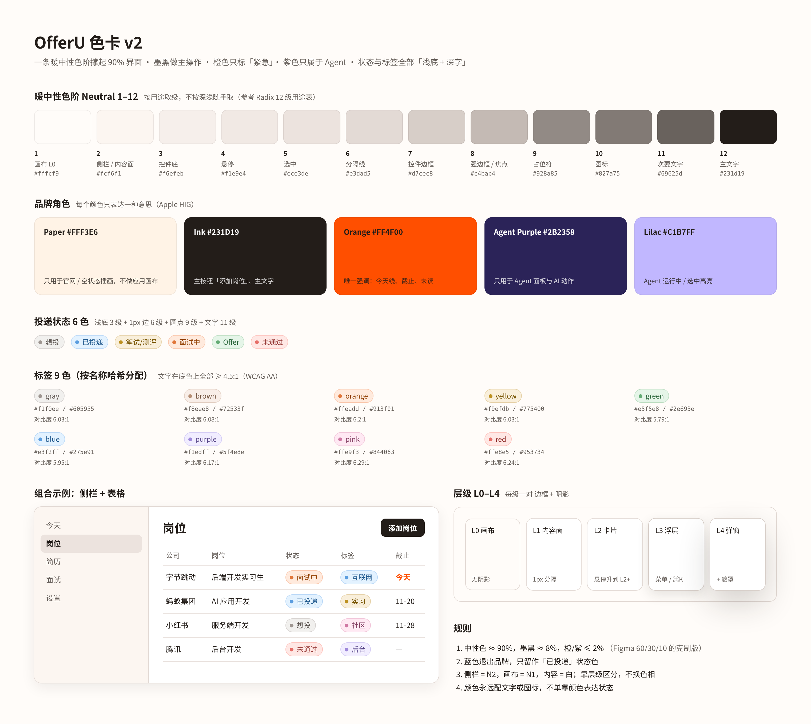

# OfferU · DESIGN.md

> **求职工作台 · Agent 协作 · 暖中性 Minimal 设计套件**
>
> 像一张收拾干净的书桌：一张米白的纸（N1 `#FFFCF9`），上面放着几张白卡片，只有一支墨黑的笔在写字。层级靠字号、字重、深浅和留白；橙色只在「今天 / 截止 / 交给 OfferU」时亮一下，紫色只出现在 Agent 身上。没有 KPI 卡、没有渐变、没有网格底。适用于校招求职者每天打开、一待就是半天的工作台。

| | |
| --- | --- |
| Accent | `#231D19` 墨黑（N12） |
| Canvas | `#FFFCF9` 暖白（N1） |
| Palette | Warm neutral · 1 个提示色 + 1 个身份色 |
| Source | `frontend/src/styles/design-tokens.css`（唯一写字面值的地方） |
| 字体 | 系统字体（SF Pro / PingFang SC / Segoe UI / Microsoft YaHei） |
| 细则 | [visual-system.md](visual-system.md) · [components.md](components.md) · [references.md](references.md) |

本文件是**一页式设计套件**，写法参照 vechooool.com 的 *gilhuybrecht* 套件（概览 → 色 → 字 → 按钮 → 图标 → 间距 → 层次 → 形状 → 内容单元 → 推导控件 → 底层逻辑 → 规范与禁忌 → 动效）。数值细则在 visual-system.md，组件规格在 components.md；三者冲突时以 Token 文件为准。

> **动手前先找参考。** 做任何新界面或动效之前，按 [references.md](references.md) 的流程在 Inspora / Awwwards / GSAP Showcase / Refero 找 2–3 个参考，写进 PR 描述。

---

## 概览 · Overview

打开是一张暖白画布，左边一条略深一级的侧栏（N2），中间是白色内容面，右边是 Agent 栏。界面退后，岗位、简历、Agent 的产出站在前面。一屏只有一个墨黑主按钮；其余都是白底描边或纯文字。

| 情绪 | 布局 | 内容宽度 | 框景 | 网格 | 图标 |
| --- | --- | --- | --- | --- | --- |
| Calm · focused · 纸感 | 侧栏 + 内容 + Agent 栏 | reading 46rem / default 72rem / wide 100rem | 有框：白色内容面坐在暖白画布上 | 流体 gutter，无固定列 | Lucide 线性 16px，描边 2 |

## 色 · Color

| 角色 | 值 | Token | 用于 |
| --- | --- | --- | --- |
| 强调（墨黑） | `#231D19` | `--ou-action-primary` / `--ou-text-primary` | 主按钮（一屏最多一个）、主文字 |
| 辅色（次要文字） | `#69625D` | `--ou-text-secondary` | 次要文字、元数据 |
| 表面 | `#FFFFFF` | `--ou-bg-surface` | 表格、卡片、弹层、输入框 |
| 背景 | `#FFFCF9` | `--ou-bg-canvas` | 画布 L0 |
| 侧栏 | `#FCF6F1` | `--ou-bg-sidebar` | 侧栏、Agent 栏 |
| 提示（橙） | `#FF4F00` | `--ou-color-orange` | 今天线、截止临近、未读、「交给 OfferU」 |
| 身份（紫） | `#2B2358` / 点 `#9E88DA` | `--ou-color-purple` / `--ou-tone-purple-dot` | 只属于 Agent：面板身份、运行中 |

完整 12 级暖中性色阶、九色状态胶囊、深色与高对比度见 [visual-system.md §2](visual-system.md#2-颜色)。色卡：

## 字 · Typography

| 角色 | 尺寸 | 字重 | 用于 |
| --- | --- | --- | --- |
| page | clamp(22px → 28px) | 600 | 页面标题（流体：`1.2rem + 0.45vw`） |
| section | 16px / 1.4 | 600 | 区块、弹窗标题 |
| body | 14px / 1.55 | 400 | 表格、表单、Agent 正文 |
| detail | 13px | 400 / 500 | 标签、元数据、次按钮 |
| pill | 12.5px | 500 | 状态 / 标签胶囊 |
| meta | 12px | 400 | 时间、快捷键、计数（`tabular-nums`） |

降一级层级至少同时换**颜色**，再换字号或字重之一。三级文字（N10）里不放必须读的信息。等宽只给代码和 ID。

## 按钮 · Buttons

| 变体 | 外观 | 用于 |
| --- | --- | --- |
| Primary | 墨黑底 + 白字 | 一屏一个：添加岗位、保存、下载 PDF |
| Secondary | 白底 + L2 描边阴影 | 普通动作 |
| Ghost | 透明 + 次要色，悬停 N4 底 | 工具条、行内动作 |
| Icon | 28px 方块，三级色 | 关闭、更多 |

悬停只换底色；按下缩到 0.97（120ms）；禁用 50% 透明。不做彩色按钮，橙色永远不是按钮底色。组件：`components/ui/Button`。

## 图标 · Iconography

Lucide 线性图标，16px，描边 2，颜色跟文字走（多数是 `--ou-text-tertiary`）。图标只做辅助：每个图标旁边都有文字或 `aria-label`。不用彩色图标、不用 emoji 当图标、不画插画式图标。

## 间距 · Spacing

| Token | 值 | 用于 |
| --- | --- | --- |
| `--ou-space-1` | 4px | 图标与文字 |
| `--ou-space-2` | 8px | 组内 |
| `--ou-space-3` | 12px | 卡片内边距 |
| `--ou-space-4` | 16px | 组间 |
| `--ou-space-6` | 24px | 区块 |
| `--ou-space-8` | 32px | 页面段落 |
| `--ou-gutter` | clamp(16px → 40px) | 页面左右留白 |

## 层次与深度 · Elevation & Depth

**纸上放卡片。** 每一级都是「1px 描边 + 阴影」成对出现，不单独用阴影。同一视图最多一层带描边的容器。

| 层 | 是什么 | 描边 | 阴影 |
| --- | --- | --- | --- |
| L0 | 画布 | — | — |
| L1 | 内容面、输入框 | N6 | — |
| L2 | 卡片、次按钮 | N6 → 悬停 N7 | 0 1 2 / 6% → 0 4 12 / 9%，上移 1px |
| L3 | 菜单、下拉、Popover | N7 | 0 8 24 / 12% |
| L4 | 弹窗、⌘K | N7 + 遮罩 | 0 24 60 / 20% |

毛玻璃只给浮在内容上的控件（⌘K、工具条）。

## 形状 · Shapes

| Token | 值 | 用于 |
| --- | --- | --- |
| `--ou-radius-control` | 6px | 按钮、输入框、菜单项 |
| `--ou-radius-card` | 10px | 卡片 |
| `--ou-radius-floating` | 14px | 浮层、弹窗、看板列 |
| `--ou-radius-pill` | 999px | 胶囊、运行胶囊 |

圆角随层级变大：越浮起来越圆。

## 内容单元 · Content

1. **岗位卡（看板）**：公司名（body 500）+ 职位（detail 次要色）+ 一行下一步 / 截止。白底 L2，没有封面图、没有分数徽章。
2. **岗位行（表格）**：行高 36px，悬停整行 N4 圆角底，不加边框。
3. **状态胶囊**：浅底 + 深字 + 同色描边 + 圆点；同一个值在所有视图同色。
4. **Agent 运行**：输入框上方一颗浮起胶囊（紫点呼吸 + 一行步骤扫光 + 「N 步 · 秒数」）；完成后收成「› 已处理 · N 次工具调用」。
5. **Context Meter**：发送键左边 20px 圆环 + 百分比；56k 压缩线起转琥珀。

不做「数字 + 标签」的 KPI 卡。

## 推导控件 · Derived

由同一批 Token 推导：输入框 = 白底 + L1 描边 + 6px 圆角，聚焦时 N8 焦点环；下拉 / 菜单 = L3 浮层 + 菜单项 N4 高亮；弹窗 = L4 + 遮罩。全部来自 `components/ui`（Radix Primitives），不手写。

## 底层逻辑 · Logical

| 规则 | 说明 |
| --- | --- |
| 三层 Token | 原始色阶 `--ou-neutral-*` → 语义 `--ou-bg-* / text-* / line-* / tone-*` → 组件类 `.ou-*` |
| 流体 | 字号、留白、侧栏宽、看板列宽都用 `clamp()`，不按断点一档一套 |
| 断点 | 验收档：390 / 768 / 1024 / 1440 / 1920；768 以下侧栏变底部标签栏 |
| hover | 只换底色或描边，卡片可上移 1px |
| focus | `:focus-visible` 显示 N8 焦点环，鼠标点击不显示 |
| prefers-reduced-motion | 所有时长、位移、错开归零；扫光变静态 |
| prefers-contrast: more | 分隔线、描边、次要文字各加深一级 |
| 审计 | `npm run design:audit` 拦截新增的裸色值、px 字号、自写阴影 / 圆角 / z-index、裸 `<select>` |

## 规范与禁忌 · Do & Don't

| ✓ Do | ✗ Don't |
| --- | --- |
| 一屏只留一个墨黑主按钮 | 不要彩色按钮、不要橙色主按钮 |
| 层级靠字号 + 颜色 + 留白 | 不要 KPI 卡、徽章墙、渐变块、网格底 |
| 橙色只给今天 / 截止 / 委托 | 不要把橙色当装饰 |
| 紫色只给 Agent | 不要用紫色表示成功或置信度 |
| 胶囊浅底深字 | 不要深底浅字胶囊 |
| 只组合 `components/ui` | 不要裸 `<select>`、手写菜单 / 阴影 |
| 二维数据在自己的容器里横滚 | 不要让整页横向滚动 |
| 做之前先找参考（references.md） | 不要凭感觉直接画 |

## 动效 · Motion

| Motion Level | Durations | Easings | Hover | Scroll | Canvas |
| --- | --- | --- | --- | --- | --- |
| subtle · 功能性 | 120 / 200 / 320ms | standard `(.2,0,0,1)`、spring `(.32,.72,0,1)` | 换底色、卡片上移 1px | 无滚动驱动动画 | 无 |

动效只回答三件事：**从哪来、到哪去、现在在干嘛**。

- 页面切换：上浮 6px + 淡入（`.ou-page-enter`）
- 列表进场：逐项错开 28ms，最多 8 项（`.ou-enter` + `--i`）
- Agent 步骤换字：淡入 + 去模糊（`.ou-swap`）；思考中：文字扫光（`.ou-shimmer`）
- 浮层：从触发点缩放 0.97 → 1；弹窗：0.96 → 1 + 遮罩淡入
- 看板拖拽：卡片拿起微倾、抬到 L3；目标列底色和焦点环淡入

```css
.ou-enter {
  animation: ou-rise-in var(--ou-motion-slow) var(--ou-ease-spring) both;
  animation-delay: calc(var(--i, 0) * var(--ou-stagger));
}
```

完整动效表见 [visual-system.md §7](visual-system.md#7-动效)。要加新动效时，先去 [GSAP Showcase](https://gsap.com/showcase/) 和 Inspora 的 Motion 分类找参考（见 [references.md](references.md)），再用 CSS + Token 实现；工作台里不引入滚动驱动或 WebGL 动画。
