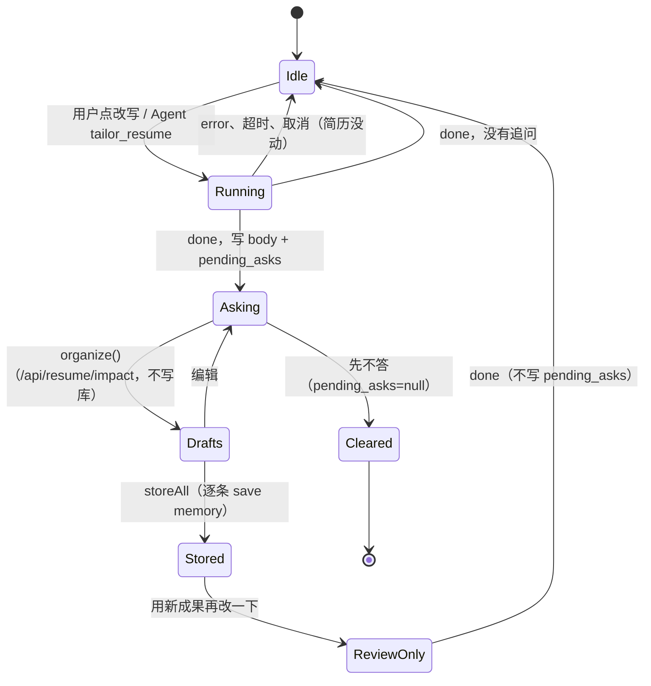
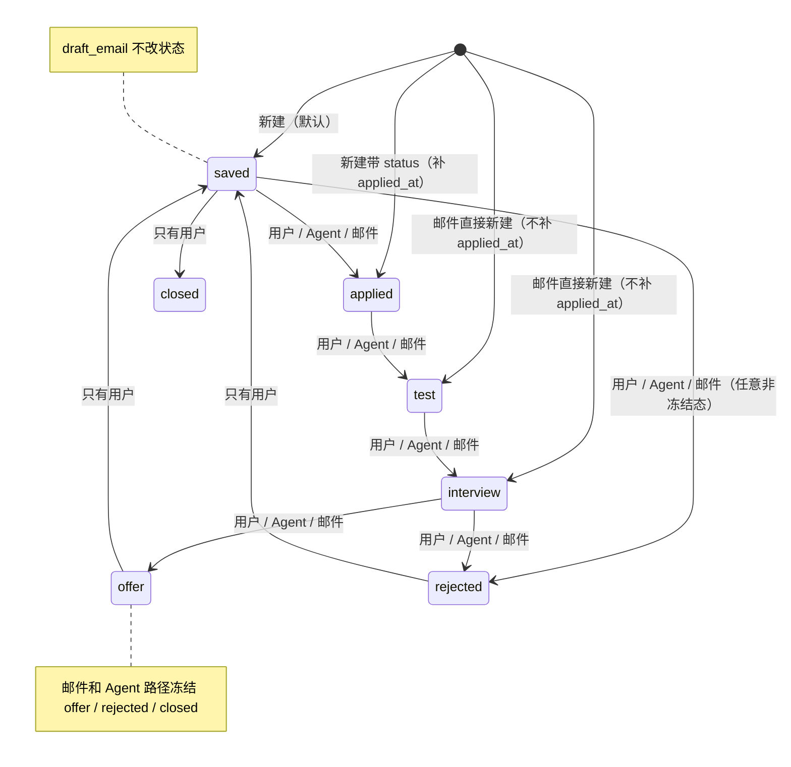
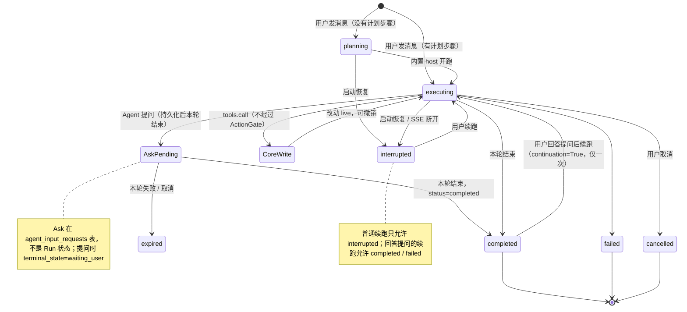
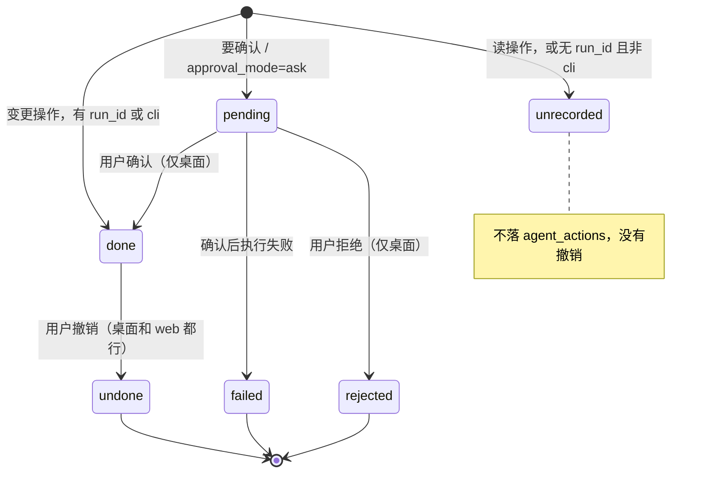
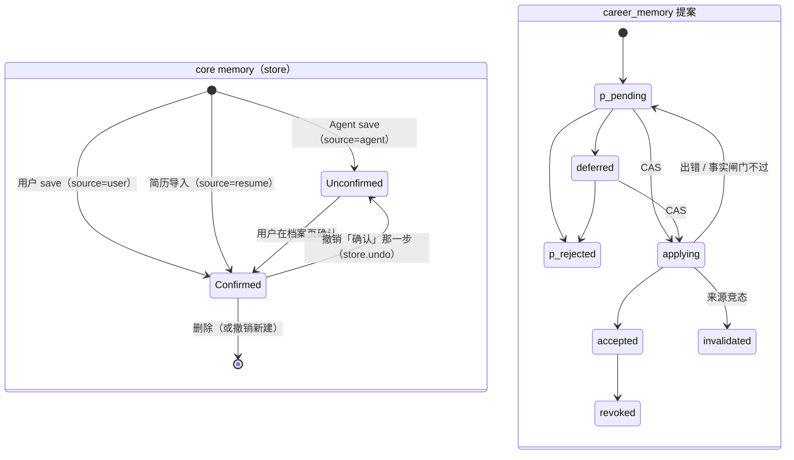

# OfferU 状态图：core 的 5 条用户流程

来源：2026-11-09 隐式状态机盘点，2026-11-10 按当前代码复核。每个子系统的事件、守卫、file:line 和验证命令在 .agents/skills/statemachine-<名字>/SKILL.md；可执行模型在 backend/tests/test_statemachine_models.py。已修的问题保留编号并标「已修」，现在是普通测试；known() 只剩 helper，没有 strict xfail 用例。

## 1. 改写 -> 追问 -> 档案 -> 只审稿

暴露的问题：

- tailor-run-asks#1 已修：ReviewOnly -> Idle 不再把第 1 轮 asks 写回 pending_asks（tailor.py:405 在 review_only 时写 None；test_review_only_does_not_write_pending_asks 通过，不再是 xfail）。
- tailor-run-asks#2 仍在：Asking 的 asks 只活在 TailorBar 的模块级 Map 里（TailorBar.tsx:25,39），刷新后 doc.pending_asks 没人读，持久化的追问不显示。
- impact-asks#1 Drafts -> Stored 不是原子的：中途失败停在「部分已存」，重试重复建记忆（TailorBar.tsx:147-149）。
- impact-asks#2 Stored 没有整体撤销。

## 2. 岗位流水线：用户、Agent、邮件

暴露的问题：

- job-pipeline#1 已修：新建即 applied（用户或邮件）也补 applied_at；再存 applied 保留原日期（tools.py:352-354），两条回归测试都是普通测试。
- job-pipeline#2 部分修：Agent 和邮件共用 tools.JOB_ORDER 只前进（tools.py:309-324），用户仍可任意改；状态检查在 store._lock 外读（tools.py:356），并发写仍有 TOCTOU。
- 用户路径没有终态：rejected / closed 也能被用户改回 saved。
- 邮件直接新建为 test / interview / offer 的岗位没有 applied_at，只有经过 applied 才有。
- draft-email#1 草稿发出后没有 sent -> applied，只能等回执或手动改。
- mail_id 撤销后不重放（有意，有测试）。
- 旧服务的 triage_status、application_progress 还是同一概念的平行状态；email_sync 已只写 core mail.apply，但 ops 仍暴露 triage_status。

## 3. 内置 Agent 运行

暴露的问题：

- actiongate#5 内置 Agent 的写入没有事前确认，只能事后撤销。
- change-undo#1、#2 已修：store.undo 先比对当前记录和这条改动的 after，不一致就拒绝（store.py:183-185），不会盖掉或删掉之后的改动；现在是普通测试。
- agent-run#1 已澄清：前端的 waiting_input 只是停放条标签（AgentPanel.tsx:87-90,282,396-409），后端没有这个 status；等 Ask 时 Run 是 completed + terminal_state=waiting_user（embedded_agent_host.py:592-622），问题本身在 agent_input_requests.status=pending。
- agent-run#2 run.finish 的终态取自外部 payload（server.py:537-561），且可以对已完成 / 已取消的 Run 再 finish；save_agent_run 不拦终态改写。
- agent-ask#1 前端的 cancelled 后端没有写入方：运行取消时待答问题落成 expired（embedded_agent_host.py:923）。
- agent-ask#2 已经 completed 的 Run 上遗留的 pending Ask 没有过期路径：abort 对终态直接返回（embedded_agent_host.py:907-908），没人回答就一直挂着。

## 4. 外部 Agent 经 ActionGate

暴露的问题：

- actiongate#1 pending -> done 和 done -> undone 没有 CAS，双击或并发会执行或恢复两次（action_gate.py:152-161,186-194）。
- actiongate#2 unrecorded 的写入没法撤销。
- actiongate#3 同参数的本地读一次允许就永久免确认（_approved_before，62-67）。
- actiongate#4 failed 是死胡同，没有重试。
- actiongate#6 undo 不拦「Agent 改完之后又被改过」：undo_preview 只提示（172-183），undo_action 照样覆盖；和 core store.undo 的拒绝策略不一致。

## 5. 记忆的两条路

规则：只有用户（tools.USER_ACTOR）能确认；tailor._facts 跳过 confirmed 为 False 的记忆（tools.py:297-305；tailor.py:88-90）。

暴露的问题：

- 两条路不相通：TailorBar 和 impact 直接写 core memory，不过 career_memory 的事实闸门。
- career_memory 里 deferred -> rejected 现在允许（career_memory.py:1062-1063）；superseded 的条目仍拒绝 revoke（1106-1108）；接受失败回 pending，不回 deferred（1238,1249）。本阶段不动旧 career_memory。
