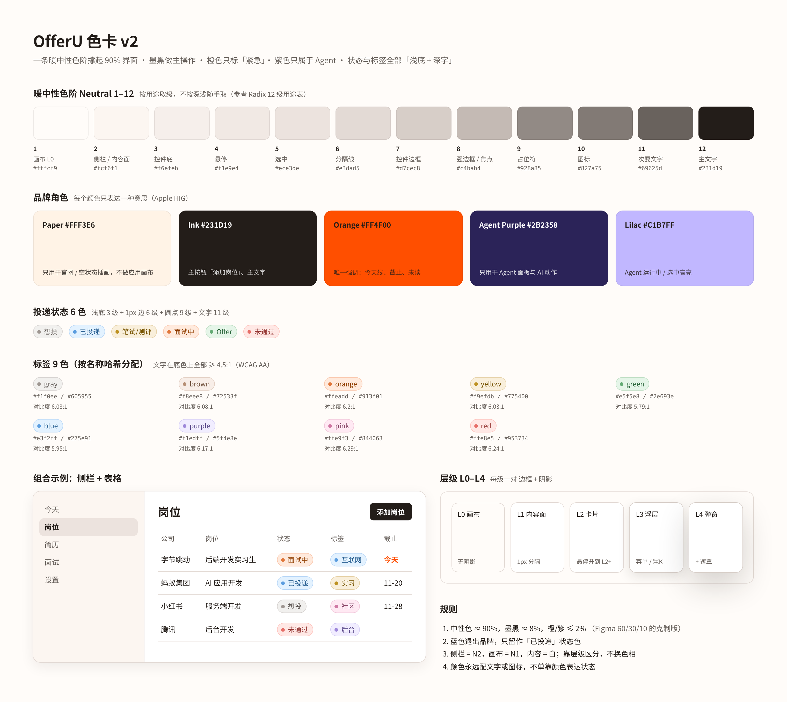

# OfferU Visual System · v3 Glass

> 状态：**有效规范**（2026-11-13 起）。取代 [v2 Minimal](archive/visual-system-v2.md)（v2 取代 [v1](archive/visual-system-v1.md)）。所有新增或迁移的界面以本文件为准；Token 在 `frontend/src/styles/design-tokens.css`，组件在 `frontend/src/components/ui/`，组件规格见 [components.md](components.md)。
>
> 参考：主参考 Inspora · Rolando「[Bleep App](https://www.inspora.design/posts/bleep-app)」（Glass / Soft / Rounded）；辅参考 Inspora · Jeet「[Coding agent](https://www.inspora.design/posts/coding-agent)」（灰壳 + 白卡、状态单色、mono 只给机器信息）；以及 Apple HIG（Materials / Color / Accessibility）、Radix Colors 色阶用途表、Notion / 飞书的文档与数据库视图。只借思路，不声称与这些产品有设计关联。
>
> **v3 相对 v2 改了什么**（用户 2026-11-13 拍板，「之前那个没有这个好看」）：v2 的「黑白灰为主、不用渐变」硬规则作废。画布换成冷暖渐变，内容面换成半透明白玻璃，L1–L2 去掉 1px 描边环只留柔和大阴影，圆角整体加大，悬停 / 选中从「灰底」改成「白胶囊」，图标放进磨砂小方块，简历编辑器改成一页文档。**没变的**：墨黑主按钮、橙色 = 紧急 / 委托、紫色 = Agent、状态胶囊九色、字号阶梯、间距、动效 Token。

## 中文速览（新 Agent 先读这一节）

1. **风格：Glass（Bleep）。** 整页底是一层很淡的冷暖渐变（左上冷蓝 `#C9D6F2` → 右下桃色 `#F6E3D2`，`--ou-bg-wash`）；侧栏、顶栏是磨砂玻璃窗格；内容是半透明白纸面；文字是暖近黑。墨黑做主按钮；橙色只表示「紧急 / 委托给 Agent」；紫色只属于 Agent；状态和标签一律「浅底 + 深字 + 圆点」胶囊。
2. **按用途取色，不按深浅取色。** 页面里只写语义 Token（`--ou-bg-*`、`--ou-glass-*`、`--ou-capsule-*`、`--ou-text-*`、`--ou-line-*`、`--ou-tone-*`），不直接写色阶编号，更不写 Hex / rgba。
3. **层级 L0–L4 靠透明度和阴影，不靠描边。** 渐变底 → 玻璃窗格 / 白纸面 → 卡片 → 浮层 → 弹窗。L1–L2 只有宽而淡的阴影（`--ou-elev-1/2`），L3–L4 多一圈 0.5px 极淡环保证可读。几乎不出现 1px 分隔线。
4. **先有组件，再有页面。** 新 UI 只组合 `components/ui`；没有合适组件就先补组件。禁止裸 `<select>`、手写菜单 / 弹层 / 阴影（`design:audit` 会拦）。
5. **弹性布局。** 页面容器按类型取宽（reading / page / wide），留白 `--ou-gutter` 随视口从 390 流到 1920；二维数据（表格、看板、甘特）在自己的容器里横向滚动，不让整页滚。

（色卡里的文字色阶和九色胶囊在 v3 仍有效；画布、面、材质以 §2.1a 为准。）

## 0. 优先级

1. 产品行为：`docs/PRD.md`；架构：`docs/DESIGN.md`。
2. 视觉、交互、响应式：**本文件** + [components.md](components.md)。
3. 数值：`frontend/src/styles/design-tokens.css`（唯一允许写字面值的地方）。
4. `globals.css` 里的旧变量（`--foreground`、`--surface`、`--border`…）已全部用 `var()` 桥接到 `--ou-*`，旧页面自动跟随 v3 Glass（`--surface` → 半透明纸面、`--surface-opaque` / `--background` → 实白，整页底由 `body` 的渐变提供）；新代码不要再引用旧变量。
5. 简历 PDF 模板是用户文档，配色独立于应用外壳，不随本规范改动。

## 1. 原则

- **内容优先**（HIG Deference）：界面退后，岗位、简历、Agent 的产出站前面。渐变只有画布这一层（`--ou-bg-wash`），不在卡片、按钮、标题上另加渐变；KPI 卡、徽章墙、网格底仍然不要。
- **玻璃分层**（HIG Materials / Bleep）：层次来自「越靠上越白、越实」和柔和阴影；悬停 / 选中是一颗实白胶囊浮起，不加描边。
- **一个颜色只表达一种意思**（HIG Color）：墨黑 = 主操作；橙 = 紧急 / 委托；紫 = Agent 来源；蓝 = 「已投递」状态；红 = 错误 / 截止 / 今天线。
- **层级靠字号、字重、颜色、留白**，阴影只用于表达「浮起」；1px 线只在必须分组的地方用（格式条分组、菜单分隔），而且是半透明的。
- **渐进式披露**：当前状态 → 一个下一步 → 次要探索。长说明折进「了解更多」，表单里每个字段的提示不超过一行。
- **不只靠颜色**：每个状态色都配文字或图标。

## 2. 颜色

### 2.1 暖中性色阶 N1–N12（OKLCH 色相 55，低彩度）

| 级 | Token | 用途 | 语义别名 |
| --- | --- | --- | --- |
| 1 | `--ou-neutral-1` `#fffcf9` | v2 画布（v3 画布见 §2.1a） | — |
| 2 | `--ou-neutral-2` `#fcf6f1` | 降低透明度时的侧栏实底 | — |
| 3 | `--ou-neutral-3` `#f6efeb` | 降低透明度时的玻璃实底 | — |
| 4 | `--ou-neutral-4` `#f1e9e4` | （v3 悬停改用半透明墨 / 白胶囊） | — |
| 5 | `--ou-neutral-5` `#ece3de` | （v3 选中改用半透明墨 / 白胶囊） | — |
| 6 | `--ou-neutral-6` `#e3dad5` | 深色 / 高对比度下的分隔线 | — |
| 7 | `--ou-neutral-7` `#d7cec8` | 深色下的控件描边 | — |
| 8 | `--ou-neutral-8` `#c4bab4` | 焦点环、高对比度分隔线 | `--ou-focus-ring` |
| 9 | `--ou-neutral-9` `#928a85` | 占位符 | `--ou-text-placeholder` |
| 10 | `--ou-neutral-10` `#827a75` | 图标、三级文字 | `--ou-text-tertiary` |
| 11 | `--ou-neutral-11` `#69625d` | 次要文字（N2 上 5.6:1） | `--ou-text-secondary` |
| 12 | `--ou-neutral-12` `#231d19` | 主文字、主按钮（N2 上 15.5:1） | `--ou-text-primary` / `--ou-action-primary` |

色阶仍在（给文字、占位、深色模式用），但 v3 的面不再从色阶里取：

### 2.1a 面与材质（v3）

| Token | 值（浅色） | 用于 |
| --- | --- | --- |
| `--ou-bg-wash` | 冷蓝 → 中性 → 桃色的渐变（三层 radial / linear） | `body` 画布，整站只此一处渐变 |
| `--ou-bg-canvas` | `#EEECF1` | 渐变的实色兜底 |
| `--ou-glass-bg` / `--ou-bg-sidebar` | 白 55% + `blur(24px) saturate(170%)` | 侧栏、Agent 栏、编辑器顶栏、聚焦顶栏 |
| `--ou-glass-strong` / `--ou-bg-floating` | 白 90% + 同样的模糊 | 菜单、下拉、Popover、弹窗、⌘K、运行胶囊 |
| `--ou-glass-menu` + `--ou-glass-blur-heavy` | 白 70% + `blur(40px)` | 浅色玻璃 Menu / Popover / LabelPicker / ⌘K（v3.1） |
| `--ou-glass-subtle` | 白 36% | 分段控件轨道、看板列、按钮组底 |
| `--ou-bg-surface` | 白 84% | 内容纸面（表格外的面板、今天页白纸、简历文档） |
| `--ou-bg-surface-solid` | `#FFFFFF` | 内容不能透出的地方：A4 纸、表格单元格、输入框、白胶囊 |
| `--ou-capsule-bg` / `-hover` / `-shadow` | 白 / 白 62% / 两层极淡阴影 | 玻璃上的悬停与选中（侧栏导航、分段控件、按钮组） |
| `--ou-bg-hover` / `--ou-bg-selected` | 半透明墨 5.5% / 8.5% | 白面上的悬停与选中（菜单项、表格行、文档里的属性值） |
| `--ou-bg-control` / `--ou-bg-field` | 半透明墨 5% / 4% | 白面上的浅底胶囊、输入聚焦底 |
| `--ou-tile-bg` | 白 72% | 磨砂图标小方块 |
| `--ou-line-separator` / `-control` / `-strong` | 半透明墨 8% / 14% / 24% | 少量必要的线；焦点环 |
| `--ou-line-faint` | 半透明墨 5% | 日历整点线等「几乎看不见」的网格线 |
| `--ou-alpha-strong / soft / muted / faint` | 0.96 / 0.78 / 0.55 / 0.4 | 浅色玻璃菜单里同一支墨色的透明度层级（标题 / 正文 / 描述 / 分组名） |
| `--ou-swatch-*` | 内白边 `-rim`、3px 深底边 `-edge`、`-shadow` / `-hover` / `-drag`、面色混合比 `-mix` | 色块 `.ou-swatch` |
| `--ou-highlight-code` | `#FBEBC8` | 行内代码的浅琥珀底（配 `--ou-font-mono`） |

阴影统一用偏冷的紫灰墨（`rgba(60,50,80,·)`），在渐变上读作「深度」而不是「脏」。`prefers-reduced-transparency` 下玻璃全部回落实底、画布回落纯色；`prefers-contrast: more` 下纸面变实白。

### 2.2 品牌角色

| 角色 | 值 | 只用于 |
| --- | --- | --- |
| Ink | `#201515` → 应用内用 N12 | 主按钮（一屏最多一个）、主文字 |
| Orange | `#FF4F00` | 今天线、截止临近、未读、「交给 OfferU」委托动作。不做普通按钮底色；橙底上用墨色字 |
| Agent Purple | `#2B2358` / Lilac `#C1B7FF` | Agent 面板身份、Agent 运行中高亮。表示「来源」，不表示成功或置信度 |
| Paper | `#FFF3E6` | 只用于官网和空状态插画，不做应用画布 |

v1 里「橙色主按钮」改为「墨黑主按钮」：Apple HIG 要求强调色只用在最需要的那一个控件上，而 OfferU 的主操作（添加岗位、保存、下载 PDF）出现频率高，用橙色会让每屏都有一块饱和色。橙色留给真正需要打断注意力的地方。

### 2.3 状态与标签色（`--ou-tone-{hue}-{bg|border|dot|text}`）

九个色相（灰、棕、橙、黄、绿、蓝、紫、粉、红），每个只取四级：浅底（3 级）、1px 描边（6 级）、圆点（9 级）、文字（11 级）。文字在底色上全部 ≥ 5.7:1（WCAG AA）。

- 投递状态六色：想投 / 不投了 = 灰，已投递 = 蓝，笔试 / 测评 = 黄，面试中 = 橙，offer = 绿，未通过 = 红。
- 单选 / 标签按文字哈希取九色之一（`toneOf()`），同一个值在表格、看板、甘特、详情里永远同色。
- 甘特条用浅底，事件菱形用圆点色。
- 禁止深底浅字的胶囊（v1 时期的 Notion 深色主题胶囊放在浅色页面上过重，已移除）。

### 2.4 深色与高对比度

- 深色：`:root.dark` 下同名 Token 有一套深色值（色阶反转、色调底 L≈0.29、文字 L≈0.86，对比 ≥ 9:1）。v3 补了一套「深色玻璃」：深蓝 → 赭色的暗渐变、烟色半透明窗格、白 7–12% 的悬停 / 胶囊；能用，未细调。页面不需要写 `dark:` 类。
- 增强对比度（`prefers-contrast: more`）：分隔线、控件描边各加深一级，次要 / 三级文字各加深一级。旧变量经桥接自动跟随。

## 3. 字体与字号

| 角色 | Token | 约值 | 用途 |
| --- | --- | --- | --- |
| Meta | `--ou-type-xs` | 12px | 时间、快捷键、计数 |
| Detail | `--ou-type-sm` | 13px | 标签、元数据、次要按钮 |
| Pill | `--ou-type-pill` | 12.5px | 状态 / 标签胶囊 |
| Body | `--ou-type-body` | 14px | 表格、表单、Agent 正文 |
| Section | `--ou-type-section` | 16px | 区块、弹窗标题 |
| Page | `--ou-type-page` | clamp 22–28px | 页面标题 |
| Doc | `--ou-type-doc` / `--ou-line-doc` | 16px / 1.6 | 文档视图正文（简历编辑器、长文） |
| Doc heading | `--ou-type-doc-heading` | 20px / 700 | 文档视图里的模块标题 |

- 系统字体 + 中文回退；输入框用正文字体，等宽（`--ou-font-mono`）只给代码和 ID，行内代码配浅琥珀底。
- 文档视图：单栏、居中、最宽 `--ou-width-doc`（46rem ≈ 736px），正文 16 / 1.6，标题粗体约 20px，段落间距宽。
- 降一级层级至少同时换颜色，再换字号或字重之一。三级文字（N10）里不放必须读的信息。

## 4. 间距与圆角

- 间距：`--ou-space-1/2/3/4/6/8`（4 / 8 / 12 / 16 / 24 / 32px）。组内 8，组间 16，区块 24。
- 圆角（v3 整体加大，越浮起来越圆）：

| Token | 值 | 用于 |
| --- | --- | --- |
| `--ou-radius-1` | 10px | 菜单项、小控件、文档里的属性值悬停底 |
| `--ou-radius-tile` | 10px | 磨砂图标小方块（28px） |
| `--ou-radius-control` / `--ou-radius-input` | 12px | 输入框、搜索胶囊、侧栏行、分段项 |
| `--ou-radius-floating` | 16px | 下拉（Select）、格式条 |
| `--ou-radius-swatch` | 16px | 色块（看板卡、日历事项）、Agent 附件拼贴 |
| `--ou-radius-card` | 18px | 卡片 |
| `--ou-radius-panel` | 20px | 窗格（侧栏、Agent）、面板、纸面、弹窗、看板列 |
| `--ou-radius-menu` | 22px | 浅色玻璃 Menu / Popover / LabelPicker / ⌘K |
| `--ou-radius-composer` | 26px | Agent 输入框卡片 |
| `--ou-radius-check` / `--ou-radius-pixel` | 5px / 1px | LabelPicker 勾选框 / 像素格加载的格子 |
| `--ou-radius-button` / `--ou-radius-pill` | 999px | 所有按钮（胶囊）、图标按钮（圆）、chip、状态胶囊 |

## 5. 层级（Elevation）L0–L4

| 层 | 是什么 | Token | 材质 | 阴影（v3） |
| --- | --- | --- | --- | --- |
| L0 | 渐变画布 | `--ou-elev-0` | `--ou-bg-wash` | 无 |
| L1 | 玻璃窗格、纸面、输入 | `--ou-elev-1` / `--ou-elev-pane` | 玻璃或白 84% | 0 1 2 / 4% + 0 6 20 / 6%，**无描边** |
| L2 | 卡片、纸面、表格白纸、次按钮 | `--ou-elev-2` → 悬停 `--ou-elev-2-hover` | 白 84% / 实白 | 0 12 32 / 10% → 0 18 44 / 16%，悬停上移 2px，**无描边** |
| L3 | 浮层（菜单、下拉、Popover、格式条、/ 菜单） | 菜单 / Popover / LabelPicker：`--ou-elev-menu`；其余 `--ou-elev-3` | 菜单类：白 70% + 40px 模糊；其余白 90% + 模糊 | 0.5px 极淡环 + 0 2 6 / 5% + 0 24 60 / 18%（菜单类）；0.5px 环 + 0 12 32 / 16%（其余） |
| L4 | 弹窗、⌘K 外壳 | `--ou-elev-4` + `--ou-scrim`（遮罩带 6px 模糊） | 白 90% + 模糊 | 0.5px 极淡环 + 0 28 72 / 24% |

- v3 去掉了 v2「描边 + 阴影必须成对」的规定：L1–L2 只用阴影和透明度分层（Bleep）；L3–L4 留 0.5px 的极淡环，是为了半透明浮层压在复杂内容上时边缘仍然清楚。
- z-index 只用 `--ou-layer-*`：sticky 10、popover 20、overlay 30、modal 40、toast 50、command 90（⌘K 必须盖住尚未迁移的旧层）；`xl` 以下 Agent 抽屉和它的遮罩用 `--ou-layer-drawer`（= toast）/ `--ou-layer-drawer-scrim`（= modal），写在 CSS 里，不在 className 写 `z-40 / z-50`。
- 毛玻璃（`--ou-glass-*`）用于外壳和浮层：侧栏、Agent 栏、编辑器顶栏、菜单、弹窗、⌘K、运行胶囊。内容纸面是半透明白（不加模糊也可读）；A4 纸、表格单元格、输入框用实白。`prefers-reduced-transparency` 下自动变实底。
- 组件类：`.ou-glass`（磨砂窗格）、`.ou-sheet`（白纸面）、`.ou-tile`（磨砂图标方块）、`.ou-capsule-row`（玻璃上的白胶囊行）、`.ou-segment`（分段胶囊）、`.ou-button-group`（一串圆形 ghost 钮）、`.ou-chip` + `.ou-chip-check`（圆形勾选筛选）、`.ou-fade-bottom`（底部渐隐），规格见 [components.md](components.md)。

## 6. 布局与响应式

| 容器 | 类 | 最大内容宽 | 用于 |
| --- | --- | --- | --- |
| reading | `.ou-page-reading` / `.ou-reading` | 46rem（约 45 个汉字一行） | 档案、设置、岗位详情正文、表单 |
| default | `.ou-page-default` | 72rem | 简历、面试 |
| wide | `.ou-page-wide` | 100rem | 今天（看板）、岗位表格 / 看板 / 甘特 |

- 留白 `--ou-gutter` = clamp(16px … 40px)，随视口流动；顶部留白同理。
- 侧栏宽 `--ou-sidebar-width` = clamp(13.5rem … 16rem)，是一块离视口边 `--ou-pane-inset`（8px）的磨砂窗格；`md`（768px）以下收成底部玻璃标签栏。
- 断点只作为验收档位：**390 / 768 / 1024 / 1440 / 1920**，横竖屏都看；布局本身靠流动宽度，而不是一档一套。
- 看板列 `flex: 1 0 0`，在 `--ou-kanban-column-min`（12.5rem）和 `--ou-kanban-column`（≤ 22rem）之间平分可用宽度（v3.1 修 1440 右侧截断）；「已结束」收起钮放在标签筛选那一行右端，不占轨道。放不下时（窄屏、开着 Agent 栏）在看板自己的轨道里横向滚动并按列吸附、右缘渐隐，窄屏（< 40rem）一列约 85vw，强制吸附。轨道左右出血到页面边缘，滚动时不被留白截断。
- 周日历：`--ou-cal-hour`（52px / 小时）、`--ou-cal-gutter`（3.5rem 时间列）、`--ou-cal-day-min`（7.5rem 一天最窄），七天放不下时在日历自己的容器里横滚。
- flex / grid 收缩边界写 `min-w-0`、`minmax(0, 1fr)`；不用 `overflow: hidden` 掩盖错位；弹层由 Radix 做碰撞翻转。

## 7. 动效

动效回答三个问题：**从哪来、到哪去、现在在干嘛**。不做纯装饰。

| Token | 值 | 用于 |
| --- | --- | --- |
| `--ou-motion-fast` | 120ms | 悬停、按下、颜色变化 |
| `--ou-motion-base` | 200ms | 浮层出现、就地换字、折叠展开 |
| `--ou-motion-slow` | 320ms | 页面切换、卡片 / 消息进场、弹窗 |
| `--ou-ease-standard` | cubic-bezier(.2,0,0,1) | 默认 |
| `--ou-ease-spring` | cubic-bezier(.32,.72,0,1) | 进场、展开（接近 iOS 弹簧） |
| `--ou-stagger` | 28ms | 列表逐项进场间隔（最多 8 项） |
| `--ou-ease-spring-soft` | cubic-bezier(.2,.9,.25,1.2) | 带一点回弹：菜单行右挪、色块悬停放大 |

| 类 | 效果 | 用在 |
| --- | --- | --- |
| `.ou-page-enter` | 上浮 6px + 淡入 | 每次切换页面 |
| `.ou-enter` + `--i` | 同上，按序号错开 | 看板卡片、工具调用行、新消息 |
| `.ou-swap`（配 `key`） | 淡入 + 去模糊 | Agent「一行步骤」换字 |
| `.ou-shimmer` | 文字扫光 | 正在思考 / 运行中 |
| `.ou-run-pill` | 浮起胶囊 + 呼吸紫点 + 计时 | Agent 运行中 |
| `.ou-activity` | 折叠头箭头旋转、内容上浮 | 「已处理 · N 次工具调用」 |
| `.ou-button:active` | 缩到 0.97 | 所有按钮 |
| `.ou-check-draw` | 勾线画出 | 完成 |
| 看板拖拽 | 卡片拿起微倾 + 抬到 L3；目标列底色和焦点环淡入 | 今天 / 岗位看板 |
| `.ou-swatch` 悬停 / 拖动 | 上浮 + 放大 1.04（spring-soft）；拖动图倾斜 -5° + `--ou-swatch-shadow-drag`，原卡变淡 | 看板卡、日历事项 |
| `.ou-menu-item` 悬停 | 白胶囊淡入 + 文字右挪 `--ou-nudge` + 箭头淡入 | Menu、⌘K |
| `BrailleLoader`（`.ou-braille`） | 标签图标 → 2×4 盲文点阵轮流亮 → 对勾画出 | LabelPicker 创建标签 |
| `.agent-composer[data-sent]` / `.agent-pixel` | 发送时整卡轻压；运行中 5×5 像素格一步一格游走 | Agent 输入框 |

`prefers-reduced-motion` 下：时长、位移、错开全部归零，扫光变静态次要色，呼吸点停止。

## 8. 无障碍

- WCAG 2.2 AA：正文 4.5:1、大字和非文字指示 3:1，以实际渲染组合为准。
- 键盘：所有可交互元素 `:focus-visible` 统一 2px 环；菜单 / 下拉 / 弹窗的键盘、焦点锁定、Esc 关闭、焦点归还由 Radix 保证。
- 触控目标 ≥ 32px（桌面）/ 44px（移动底栏）。
- 中文输入法选词时回车不提交；长公司名、中英混排、Emoji 都要截断并提供完整文本（title 或详情）。

## 9. HIG 检查清单（每个 UI PR 填）

- [ ] 这一屏的主任务和唯一主按钮是什么？是否只有一个墨黑实心按钮？
- [ ] 颜色是否都来自语义 Token？每个状态色是否配了文字 / 图标？
- [ ] 每个容器属于 L0–L4 哪一层？有没有新加 1px 描边（v3 原则上不加）？悬停 / 选中在玻璃上是不是白胶囊？
- [ ] 是否只组合了 `components/ui`？有没有裸 `<select>`、手写菜单 / 弹层 / 阴影？
- [ ] 390 / 768 / 1024 / 1440 截图：无横向整页滚动、无裁切、无挤压；Agent 栏开 / 关都看过。
- [ ] 键盘走一遍：Tab 顺序、焦点可见、Esc 返回、焦点归还。
- [ ] 空 / 加载 / 失败 / 重试状态都设计过；保存失败保留草稿。
- [ ] 增强对比度、减少动态效果、深色（若已迁移）下检查过。

## 10. 质量门禁

在 `frontend/` 执行：`npm run design:audit`、`npm run design:audit:test`、`npm run typecheck`、`npm test`、`npm run build`。`design:audit` 阻止新增违规（字面颜色、Tailwind 色板、px 字号、任意圆角 / 阴影 / z-index、裸控件），历史债只报告。不要放宽规则让 CI 变绿。

## 11. 迁移状态（2026-11-13）

v3 Glass 落地：Token + 外壳（PR #196），简历编辑器文档化（PR #197）；v3.1：浅色玻璃菜单 + 标签选择器 + ⌘K 两栏（PR #198）、周日历 + 色块（PR #199）、Agent 窗格 + 输入框（PR #200），各自怎么看见 [DESIGN.md](DESIGN.md) 的「v3.1 新增 · 怎么看」。旧变量（`--surface`、`--border`、`--background`…）全部桥接到 v3，未迁移的页面自动跟随渐变底、半透明面、胶囊按钮；页面里写死的白底 / 1px 边框是历史债，`design:audit` 有统计。

**怎么看**：`frontend/` 里 `npm run build`，`backend/` 里 `OFFERU_RUNTIME_MODE=lite uvicorn app.main:app --port 8766`（后端直接托管 `frontend/dist`），打开 `http://127.0.0.1:8766/#/`（今天）、`#/jobs`（岗位）、`#/resume`（简历编辑器）；开发时 `npm run dev` 看 `http://127.0.0.1:7410`。

| 范围 | 状态 |
| --- | --- |
| v3 Token（渐变底、玻璃、柔和阴影、大圆角、白胶囊） | ✅ |
| 外壳：磨砂侧栏窗格、图标小方块、白胶囊导航、分段二级标签、磨砂 Agent 开关 | ✅ |
| 今天：看板玻璃列 + 白卡、「要做的事 / 最近改动」白纸面 | ✅ |
| 岗位：表格放在大圆角白纸上、视图分段胶囊、工具按钮组 | ✅ |
| 简历编辑器：一页文档（无灰框、16 / 1.6、粗体模块标题、左侧留白把手） | ✅ → 2026-11-14 改成 offershow 式三栏（模块管理 · 预览 · 编辑 / 排版 / 模版），见 DESIGN.md「简历编辑器」 |
| 设置、面试、档案页内部的写死边框 / 白底 | ✅ 换成语义 Token：带框容器 → `.ou-sheet`，框内小块 → `--ou-bg-control` 圆角底，描边按钮 → `ou-button-secondary`，白底 → `--ou-bg-surface-solid`，弹窗标题 / 底栏分隔线去掉（2026-11-14）；剩余是列表分隔线（`--ou-line-separator`） |
| 今天页 / 日程的原生下拉与日期框 | ✅ `Select` + 新组件 `DatePicker`（今天「加一件事」、日历「新建事项」、复盘「面试日期」、设置的接口协议 / 模型列表、档案「性质」）；岗位表格 / 详情抽屉内联改投递日、甘特内联「加事项」仍是原生控件 |
| 深色玻璃 | ⏳ 能用，未细调 |
| 旧变量桥接到 v3 | ✅ 全站 |
| 外壳：侧栏宽度流动 | ✅ |
| 今天：wide 容器 + 阅读宽度段落、看板 L2 卡片 + 流动列宽 | ✅ |
| 岗位：浅色胶囊、墨黑「添加岗位」、wide 容器、甘特状态色 | ✅ |
| ⌘K：Token 化（L4、毛玻璃、层级） | ✅ |
| 组件层 `components/ui`（Button / Field / Select / Menu / Popover / Dialog / Panel / Pill / ContextUsageRing） | ✅ 已建，页面逐步替换 |
| 岗位表格内部的筛选 / 排序 Popover、状态菜单换成 `components/ui` | ✅ PR #198（浅色玻璃 Menu / Popover、LabelPicker） |
| ⌘K 两栏（索引 + 预览） | ✅ PR #198 |
| 周日历视图 + 看板 / 日历色块、1440 看板截断修复 | ✅ PR #199 |
| Agent 窗格 + 输入框（浮动磨砂窗格、空状态建议、玻璃输入卡、像素格加载） | ✅ PR #200 |
| Agent 栏：运行胶囊、一行步骤、上下文用量环接数据 | ⏳ 需要后端在 run 事件里给 token 用量 |
| 设置、面试页 | ⏳ 按页迁移 |
| 深色模式开关 | ⏳ Token 已备好（含 v3 深色玻璃），待旧页面迁完再开 |
